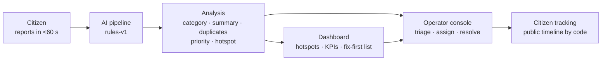
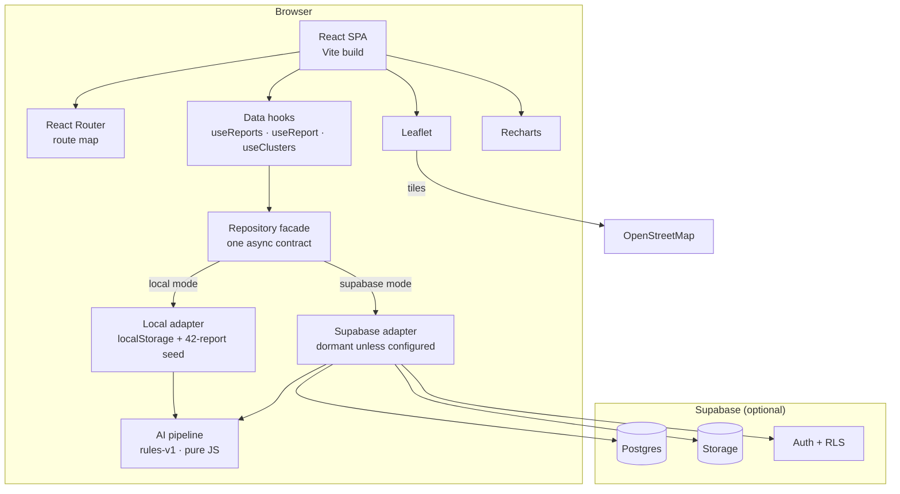
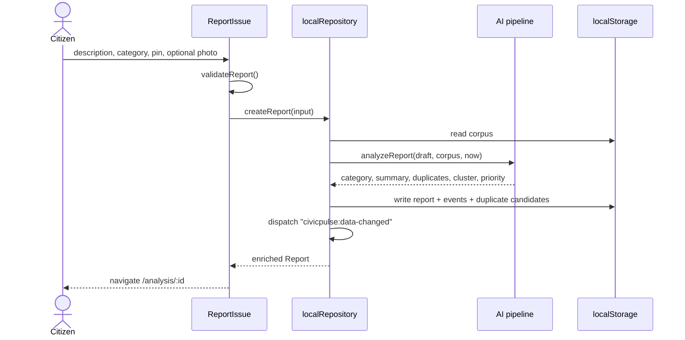

# CivicPulse AI

> **From complaints to action.**

CivicPulse AI is a working prototype that turns scattered civic complaints into **prioritized, explainable and trackable action**. A citizen reports an issue in under a minute; a deterministic AI pipeline classifies it, summarises it, finds likely duplicates, scores its priority with visible reasoning, and links it to a geographic hotspot. An operator then assigns, progresses and resolves it, while the citizen follows every step with a tracking code.

Built solo for **PromptWars x ASTRA — AI for Civic Impact** in an 8-hour build window.

| Field | Value |
| --- | --- |
| **Status** | Working prototype — full citizen → AI → operator → citizen loop implemented |
| **AI version** | `rules-v1` — deterministic, inspectable, runs in the browser |
| **Data mode** | Local-first (`localStorage` + 42-report seed); Supabase adapter wired but dormant |
| **Stack** | React 18 · Vite 5 · Tailwind 3 · Leaflet · Recharts |
| **Repository** | <https://github.com/RiteshKanyal23/prompt-wars> |
| **Node** | ≥ 20.11 |

### Quick start

```bash
npm install
npm run dev
```

Open <http://localhost:5173/>. No environment variables are needed — the first load seeds 42 synthetic reports into `localStorage`. Use **Reset demo data** in the footer to restore the seed at any time.

---

## Contents

1. [The problem](#1-the-problem)
2. [What CivicPulse does](#2-what-civicpulse-does)
3. [Feature tour](#3-feature-tour)
4. [How the AI works](#4-how-the-ai-works)
5. [Architecture](#5-architecture)
6. [Tech stack](#6-tech-stack)
7. [Getting started](#7-getting-started)
8. [Data modes and demo data](#8-data-modes-and-demo-data)
9. [Five-minute demo](#9-five-minute-demo)
10. [Testing and quality](#10-testing-and-quality)
11. [Design system and accessibility](#11-design-system-and-accessibility)
12. [What is real, what is mocked](#12-what-is-real-what-is-mocked)
13. [Limitations](#13-limitations)
14. [Roadmap](#14-roadmap)
15. [Project structure](#15-project-structure)
16. [Documentation](#16-documentation)
17. [Acknowledgements](#17-acknowledgements)

---

## 1. The problem

Urban local bodies receive civic complaints through phone calls, WhatsApp, social media, walk-ins and paper registers. That creates five recurring failures:

1. **Fragmentation** — the same pothole is reported ten times and handled as ten unrelated tickets.
2. **No triage** — a live electrical wire and a faded road marking share one first-in-first-out queue.
3. **Invisible patterns** — a drain blockage, waterlogging and road damage on one street look like three categories, not one failing piece of infrastructure.
4. **No feedback loop** — citizens rarely learn whether their complaint was received, assigned, fixed or rejected.
5. **No defensible decisions** — decision-makers cannot explain why one ward received attention before another.

CivicPulse AI addresses all five with one loop: **capture → understand → reveal → act**.

---

## 2. What CivicPulse does

### The loop



### Five AI capabilities

| Capability | Technique | What the user sees |
| --- | --- | --- |
| **Categorisation** | Weighted keyword lexicon + token overlap | Category, confidence, top-3 alternatives, low-confidence warning |
| **Summarisation** | Extractive sentence ranking + template | ≤220-character summary built only from the citizen's words |
| **Duplicate detection** | TF-IDF cosine + category + haversine distance + time decay | Ranked candidates with separate text/geo/time/category scores |
| **Explainable prioritisation** | Additive weighted model with a critical-hazard floor | 0–100 score, P0–P3 band, factor table whose points sum to the score |
| **Hotspot detection** | 0.003° grid bucketing + 30-day window + category family | Cluster membership, member count, radius, trend, action brief |

Everything runs locally in pure JavaScript. There are no network AI calls, no API keys and no hidden model weights.

### Product principles

| # | Principle | How it shows up |
| --- | --- | --- |
| P1 | **Under a minute to report** | One screen, smart defaults, optional photo, map tap, no account wall in demo mode |
| P2 | **AI advises, humans decide** | Duplicate merges, category overrides and priority overrides require an operator action |
| P3 | **Show your work** | Priority factors, duplicate component scores and cluster membership are always visible |
| P4 | **Mobile-first** | Every citizen flow works at 360 px; operator views use desktop width |
| P5 | **No fake integrations** | Local adapter by default; notifications and dispatch are labelled `MOCKED` |
| P6 | **Calm civic design** | Navy authority, white clarity, teal action; red only for genuine P0 states |
| P7 | **Demo determinism** | Same inputs produce the same AI output, so the live demo cannot drift |

---

## 3. Feature tour

### `/` — Home

Explains the product in ten seconds: hero, live stat strip computed from the repository (not hard-coded), the four-stage loop, AI capability cards, a featured hotspot preview and primary CTAs.

### `/report` — Report an issue

A single page with three visual groups instead of a hidden wizard:

1. **What is the problem?** Title (optional), description (20–1,000 chars), category select and a real **Suggest category** button that calls the classifier on the current text.
2. **Where is it?** Leaflet map with tap-to-pin and a draggable marker, lat/lng readout and an editable landmark label. No geolocation prompt on load.
3. **Evidence and contact.** Optional image (≤5 MB, jpg/png/webp) stored as **evidence only**, optional contact fields, and a consent checkbox.

On submit, validation runs, the full pipeline executes, the report + events + AI output are persisted, and the citizen lands on `/analysis/:id` with a copyable `CP-XXXXXX` tracking code. The form has a sticky action bar on mobile and preserves its values on error.

### `/analysis` and `/analysis/:id` — AI analysis

The explainability surface. The overview shows the pipeline stages, latest analysis, recent-report table and a model card. The detail page shows:

- original description, photo disclaimer and mini-map;
- AI summary labelled as generated from the description;
- category with confidence bar and alternatives;
- **priority factor table** — `Factor | Points | Why` — plus a plain-language verdict;
- duplicate candidates with text/geo/time/category component bars;
- hotspot membership with count, category mix, radius and trend;
- model card line: `rules-v1 · deterministic · N ms`.

Low confidence (< 0.45) shows a review notice. No cluster shows the "needs 3 related reports" message. An unknown id shows a lookup, not a crash.

### `/dashboard` — Decision-maker view

- Five KPI cards: total, open, P0 + P1, resolved in 30 days, duplicate rate.
- Leaflet map with priority-coloured pins, hotspot circles, popups and a legend.
- Ranked **Fix first** list; each row expands to its priority factors.
- Charts: reports by category (bar), priority mix (donut), 14-day trend (area).
- Hotspot cards with count, category mix, average priority and trend.
- **Action brief** modal generated from real cluster fields, with a copy button and a `MOCKED: no dispatch performed` note.
- Filters (category, status, band, search) stored in URL query params.
- Loading skeletons, empty states and a data-honesty footer.

### `/admin` — Operator console

Four tabs: **Queue**, **Duplicates**, **Hotspots**, **Reports**.

- Priority-sorted queue (table on desktop, cards on mobile).
- Detail drawer with AI reasoning, map, history, assignment, SLA default by band, status stepper, public and internal notes.
- Duplicate review with side-by-side text and component scores; confirm or reject with a reason.
- Hotspots tab with brief generation.
- Reports tab with search and client-side CSV export (formula-injection safe).

Workflow transitions are enforced in one place and guarded in the service, so an invalid status cannot be reached through the UI:

```text
submitted → triaged → assigned → in_progress → resolved → closed
     │          │          │            │
     └──────────┴──────────┴────────────┴──→ rejected (reason required)
     └──────────────────────────────────────→ duplicate (linked to parent)
```

Every action appends an immutable `report_event`; internal notes never reach the public route.

### `/track` and `/track/:code` — Citizen tracking

Case-insensitive code lookup with recent codes in local mode. The timeline view shows a status hero, expected SLA, citizen-friendly priority wording, a vertical public-event timeline, report summary and resolution note. Invalid codes get a helpful empty state, never a 404.

### `*` — Not found

Friendly page with links home and to the report form.

---

## 4. How the AI works

### Pipeline

```text
Report (title, description, category, lat/lng, createdAt)
  │
  ├─ normalize.js   lowercase · strip punctuation · stopwords · sentences
  ├─ classify.js    weighted lexicon → category, confidence, top-3 alternatives
  ├─ summarize.js   extractive sentence ranking → ≤220-char summary
  ├─ duplicates.js  TF-IDF cosine + category + geo + time → ranked candidates
  ├─ clusters.js    0.003° grid · 30-day window · minimum 3 reports
  └─ priority.js    additive factors + critical-hazard floor → score, band, verdict
        │
        ▼
AiAnalysis { version, category, confidence, summary, duplicates,
             priority, cluster, processingMs, processedAt }
```

`pipeline.js` is the only public entry point. Individual modules are exported for tests. No AI module imports React, the repository or `window`; `now` is injected so runs are reproducible.

### Duplicate scoring

Candidates must be within **300 m** and **21 days**, with a matching category/family or meaningful lexical overlap. The score is a weighted sum of four inspectable components:

| Component | Weight | Meaning |
| --- | --- | --- |
| Text | 0.55 | TF-IDF cosine between title + description |
| Category | 0.20 | 1.0 same category, 0.5 related family, 0 otherwise |
| Geo | 0.15 | Linear decay from the report location to 300 m |
| Time | 0.10 | Linear decay from the report date to 21 days |

| Threshold | Value | Behaviour |
| --- | --- | --- |
| Floor | 0.55 | Below this, no candidate is returned |
| Review | 0.62 | Shown as a candidate for operator review |
| Strong | 0.82 | Highlighted as a strong likely duplicate |

Nothing auto-merges. An operator confirms or rejects, and only confirmed duplicates add corroboration points.

### Priority model

```text
score = category severity        (12–38)
      + urgency language         (0–20, capped)
      + cluster impact           (0–20)
      + duplicate corroboration  (0–10)
      + recency                  (0–10)
      + critical hazard floor    (raises the total to 80 when a life-safety event is detected)
```

| Band | Score | Citizen wording | SLA default |
| --- | --- | --- | --- |
| **P0** Critical | 80–100 | "Urgent — safety risk" | 4 hours |
| **P1** High | 60–79 | "High — treated as urgent" | 24 hours |
| **P2** Medium | 40–59 | "Medium — scheduled" | 72 hours |
| **P3** Low | 0–39 | "Low — routine" | 7 days |

The critical-hazard floor is explicit, not a hidden bonus: the factor row shows exactly the points needed to reach 80, so the displayed factors always sum to the displayed score. The hazard list is event-based — "has collapsed" escalates, "will collapse" does not.

### Clustering

Coordinates are bucketed into **0.003° cells** (roughly 330 m). A cluster needs **≥ 3 reports in 30 days**; the pipeline computes the centroid, radius, category mix, hotspot score and trend. This mirrors DBSCAN's intent without the tuning cost. Cell-boundary splits and dense-area merging are known limitations.

### Determinism and versioning

- Stable sort tie-breakers: category key alphabetically; duplicate score then report id.
- No random sampling, temperature or model calls.
- `AI_VERSION = 'rules-v1'` is stored with every report.
- `processingMs` is the only varying field and is excluded from determinism tests.
- Changing weights requires a new version (`rules-v2`) so old reports stay readable.

### Explainability contract

The model *is* the explanation: matched lexicon terms, extractive summaries, separated duplicate components, additive factor points and cluster fields. There is no post-hoc approximation of a black box.

---

## 5. Architecture



### Layering rule

```text
app/         App, router, providers, error boundary
pages/       Route composition + data orchestration
components/  Presentational: layout · ui · map · charts · reports · admin
hooks/       useReports, useReport, useClusters, useToast, useFocusTrap, …
services/    repository facade → adapters → AI pipeline
lib/         constants, env, geo, format, validation, workflow, csv
data/        synthetic seed
```

Dependencies point downward only. Components never import a page or the repository; only `src/services/*` touches storage or Supabase.

### State management

No global store. Server data lives in hooks, URL state in the router, form state in components, UI state locally, and toasts/mode in context. Mutations dispatch a `civicpulse:data-changed` event and open hooks refetch. At demo scale this is simpler and less bug-prone than a cache layer.

### Data flow on submit (local mode)



### Local storage layout

| Key | Contents | Reset |
| --- | --- | --- |
| `civicpulse:v1:reports` | Reports with AI output and workflow state | Deleted by "Reset demo data" |
| `civicpulse:v1:events` | Append-only workflow/timeline events | Same |
| `civicpulse:v1:duplicates` | Candidate duplicate pairs and review status | Same |
| `civicpulse:v1:meta` | `{ seeded, seededAt, version }` | Same |

The schema version is embedded in the key. A future breaking change uses `v2` and a migration. Storage quota errors are caught and surfaced as a clear "reset demo data" message.

---

## 6. Tech stack

| Layer | Choice | Why |
| --- | --- | --- |
| UI | React 18.3 | Component model, ecosystem, fast iteration |
| Build | Vite 5.4 | Instant dev server, simple static build |
| Styling | Tailwind CSS 3.4 + custom tokens | Distinctive civic identity without a heavy component library |
| Routing | react-router-dom 6.28 | Nested layouts, URL state |
| Maps | Leaflet 1.9 + react-leaflet 4.2 | Keyless, open, reliable |
| Charts | Recharts 2.13 | Responsive React charts |
| Icons | lucide-react | Consistent, tree-shakeable |
| Backend (optional) | Supabase JS 2.47 | Postgres, Storage, Auth, RLS |
| Tests | Vitest 2.1 | Fast unit + SSR smoke tests |
| Lint | ESLint 9 (flat config) | Zero-warning baseline |

---

## 7. Getting started

### Prerequisites

- Node.js **≥ 20.11**
- npm 10+

### Run locally

```bash
git clone https://github.com/RiteshKanyal23/prompt-wars.git
cd prompt-wars
npm install
npm run dev
```

The dev server runs at <http://localhost:5173/> and opens automatically. No environment variables are required: without Supabase credentials the app resolves to **local demo mode** and seeds 42 reports on first load.

### Environment variables (optional)

Copy `.env.example` to `.env.local` only if you want to change the demo centre or connect Supabase:

```bash
cp .env.example .env.local
```

| Variable | Default | Purpose |
| --- | --- | --- |
| `VITE_DATA_MODE` | `auto` | `auto` \| `local` \| `supabase`. `auto` picks Supabase only when both credentials exist |
| `VITE_SUPABASE_URL` | empty | Supabase project URL (public) |
| `VITE_SUPABASE_ANON_KEY` | empty | Supabase anon key (public, protected by RLS) |
| `VITE_DEMO_CENTER_LAT` | `12.9716` | Map centre latitude |
| `VITE_DEMO_CENTER_LNG` | `77.5946` | Map centre longitude |
| `VITE_DEMO_CITY_LABEL` | `Sector 12, Demo City` | Display label |
| `VITE_AI_LLM_ENABLED` | `false` | Reserved for a future LLM adapter; the prototype never calls one |
| `VITE_AI_PROXY_URL` | empty | Reserved proxy URL for that adapter |

> **Never** put a Supabase service-role key or an LLM provider secret in a `VITE_*` variable. Everything prefixed with `VITE_` is shipped to the browser.

### Scripts

| Command | What it does |
| --- | --- |
| `npm run dev` | Start Vite on port 5173 |
| `npm run build` | Production build to `dist/` |
| `npm run preview` | Serve the production build locally |
| `npm run lint` | ESLint over the repository |
| `npm run test` | Run the Vitest suite once |
| `npm run test:watch` | Watch mode |
| `node scripts/evaluate-seed.mjs` | Print the AI quality metrics on the 42-report seed |

### Deployment

The app is a static SPA. Deploy `dist/` to Vercel, Netlify or any static host with an SPA rewrite to `index.html`. No server process, database or secret is required for the demo build.

> The prototype is **not safe to expose publicly as-is** in local mode: `/admin` has no authentication. See [Limitations](#13-limitations).

---

## 8. Data modes and demo data

### Local mode (default)

- 42 human-written synthetic reports, spread over 30 days around a fictional Bengaluru centre.
- 8 deliberate duplicate groups (5 pairs + 3 triplets).
- 3 life-safety P0 cases: live wire, open manhole near a school, partial road collapse.
- 2 seeded hotspots: **Sector 12** (7 reports) and **Ward 4 Market** (5 reports).
- All 7 categories represented: 11 water, 9 roads, 8 waste, 6 electricity, 4 sanitation, 3 public safety, 1 other.
- Current computed distribution: **3 P0 / 5 P1 / 11 P2 / 23 P3**.
- 6 local placeholder images, labelled as samples; no real personal data.

On first load the seed is analysed in a **second pass** against the full corpus, so duplicate candidates and clusters are real rather than hard-coded. Use **Reset demo data** in the footer to restore the seed.

### Supabase mode

The Supabase adapter implements the same async repository contract as the local adapter and computes the same AI output. It is wired but **dormant**: this repository does not include the SQL schema, RLS policies or seed script for a Supabase project. Enabling it requires creating the schema and setting `VITE_DATA_MODE=supabase` plus credentials. Until then, treat Supabase mode as post-hackathon work.

### Seed evaluation

```bash
node scripts/evaluate-seed.mjs
```

Current output:

| Metric | Result |
| --- | --- |
| Duplicate groups recovered | **8 / 8** |
| P0 reports in the top 5 by score | **3 / 3** (all at the 80-point hazard floor) |
| Clusters found | **2** — Sector 12 (7 reports, 31 m) and Ward 4 Market (5 reports, 30 m) |
| Low-confidence classifications | **3 / 42** |
| Priority mix | 3 P0 · 5 P1 · 11 P2 · 23 P3 |

---

## 9. Five-minute demo

| Time | Beat | What to show |
| --- | --- | --- |
| 0:00–0:30 | **Hook** | Home: "Cities don't lack complaints. They lack a way to act on them." Show the four-stage strip. |
| 0:30–1:30 | **Capture** | Open `/report` in a phone-sized window. Paste a waterlogging description, tap the map in Sector 12, attach a sample photo, submit. |
| 1:30–2:30 | **Understand** | `/analysis/:id`: category + confidence, summary, duplicate candidates with component scores, priority factor table, hotspot membership. Read the score and its drivers aloud. |
| 2:30–3:15 | **Reveal** | `/dashboard`: point at the Sector 12 circle, priority mix, Fix-first list. Open the action brief. |
| 3:15–4:15 | **Act** | `/admin`: confirm one duplicate, assign Drainage Cell, move to In Progress, add a public note, resolve. |
| 4:15–4:45 | **Close the loop** | `/track/:code`: timeline shows Received → Assigned → In progress → Resolved with the note. |
| 4:45–5:00 | **Honesty** | State what is real (AI pipeline, repository, workflow), what is mocked (notifications, departments, dispatch), and one limitation (no image AI). |

**Pre-seeded example:** `CP-7K2M9Q` — "Storm drain overflowing near Sunrise School" in Sector 12, currently P1 with two duplicate candidates. Use it to explore the analysis page without submitting first.

**Backup plan:** the build defaults to local mode. If a Supabase demo is attempted and the network fails, set `VITE_DATA_MODE=local`, reload, and everything except map tiles still works. The footer badge always states the active mode.

The full pre-flight checklist, recovery cards, judge-style answers and stopwatch log are in [`docs/demo-rehearsal.md`](docs/demo-rehearsal.md).

---

## 10. Testing and quality

```bash
npm run lint
npm run test
npm run build
```

Current baseline (30 October 2026):

| Check | Result |
| --- | --- |
| Unit + SSR smoke tests | **127 passed in 15 files** |
| ESLint | **0 problems** |
| Production build | Passes — code-split into vendor, Supabase and route chunks; largest chunk 416 kB (113 kB gzip) |
| Browser QA (headless Chrome) | 9 routes with **0 console errors**; 36/36 width checks with no horizontal scroll; offline core flow passes with fonts/tiles blocked |
| Seed evaluation | **G3 PASS** — 8/8 duplicate groups, 3/3 P0 in top 5, 2 clusters |

The suite covers:

- AI classification, band boundaries, duplicate scoring, cluster formation, determinism and the hazard floor (`src/services/ai/__tests__/ai.test.js`);
- repository create/read/update, tracking-code lookup, public vs internal events and reset (`src/services/local/__tests__/localRepository.test.js`);
- validation limits and tracking-code formats (`validation.test.js`, `referenceCode.test.js`);
- workflow transitions, CSV escaping, report statistics and area grouping (`workflow.test.js`, `csv.test.js`, `reportStats.test.js`);
- geo maths, date/number formatting and error-copy mapping (`geo.test.js`, `format.test.js`, `errors.test.js`);
- Supabase snake_case ↔ camelCase mappers (`mappers.test.js`);
- analysis selectors and tab keyboard navigation (`analysis.test.js`, `tabs.test.js`);
- SSR rendering of every route (`src/app/__tests__/routes.smoke.test.js`).

**Bundle note:** the build splits React, the dormant Supabase SDK, Leaflet and the chart-heavy dashboard into separate chunks. The initial app chunk is ~257 kB (66 kB gzip); the ~416 kB chart chunk loads only on the dashboard route.

### Phase gates

Implementation is complete through the operator workflow. Gates **G0–G7** are signed off with evidence in [`docs/decision-log.md`](docs/decision-log.md). **G8 is conditionally passed:** all automated, accessibility, responsive and offline checks are green, while the two timed presenter rehearsals and the narrated backup video remain manual follow-ups tracked in [`phases.md`](phases.md) and [`docs/demo-rehearsal.md`](docs/demo-rehearsal.md).

---

## 11. Design system and accessibility

### Visual language

- **Navy** (`#0B1F3A`) for authority and structure; **white** for clarity; **teal** (`#0FB5A6`) for action and progress.
- Red is reserved for genuine P0 states and destructive actions.
- Inter with a system-font fallback; `tabular-nums` for KPIs.
- Container max-width 1280 px; 8/12/16/20 px radii; one soft card shadow.
- Mobile-first breakpoints at 360, 640, 768, 1024 and 1280 px.

### Accessibility

- Semantic landmarks, one `h1` per page and a skip link before the header.
- Visible `focus-visible` ring (2 px teal + 2 px offset).
- 44 px minimum tap targets; text ≥ 14 px.
- Status and priority always include text, not colour alone.
- Focus-trapped modals and drawers with Escape-to-close and scroll lock.
- Map has a parallel list/table view for keyboard and screen-reader users.
- Form errors linked with `aria-describedby`; toast region uses `aria-live="polite"`.
- `prefers-reduced-motion` disables non-essential transitions.
- Responsive tables become cards below `md`; no horizontal scroll at 360 px.

---

## 12. What is real, what is mocked

### Real

- Report capture, validation and persistence (local adapter, or Supabase when configured).
- Classification, extractive summary, duplicate scoring, priority scoring, hotspot detection and action-brief generation — all executed by code in this repository.
- Status workflow, append-only event log and citizen tracking timeline.
- Map, charts and KPIs computed from the same stored reports.
- Client-side CSV export with formula-injection protection.

### Mocked or simulated

| Item | Status |
| --- | --- |
| Department names and assignment targets | Fictional (Public Works, Drainage Cell, Sanitation, Electrical, Public Safety, Ward Office) |
| SMS / email / WhatsApp notifications | **Not sent**; labelled `MOCKED` |
| Municipal CRM / 311 dispatch | **Not integrated**; the action brief is a recommendation only |
| Citizen identity | Anonymous local demo profile; no real accounts |
| Photos | Synthetic placeholders or user-provided demo images; **not analysed by AI** |
| "Live" dashboard | Refreshes on load, not a real-time stream |
| Operator authentication | No auth wall in local mode; banner states the admin console is unauthenticated demo data |

---

## 13. Limitations

### Where the AI can be wrong

- **Classification** is lexicon-based: it misses sarcasm, code-mixed language (for example Hinglish) and novel issue types.
- **Duplicate detection** can miss paraphrases with no shared vocabulary. Thresholds were tuned on a small synthetic corpus.
- **Priority weights** are expert guesses, not learned from resolution outcomes, and can over-rank dramatic language.
- **Grid clustering** splits issues that straddle cell boundaries and can merge unrelated issues in dense areas.
- **Summaries** are extractive and can repeat typos or awkward phrasing.

### Prototype gaps

- AI runs in the browser, so a client can forge AI output. Production must recompute server-side.
- Supabase schema, RLS policies, auth flows and seed SQL are **not included** in this repository.
- No image understanding, geocoding, speech, translation or predictive time-to-fix.
- No automatic duplicate merging — by design, a human confirms.
- No multi-city tenancy, billing, SSO or audit-grade compliance.
- No end-to-end (Playwright) tests yet; coverage is unit + SSR smoke.
- Map tiles and the Inter webfont require network access; offline the map is grey and the font falls back.
- Local data lives in one browser profile and is lost if site data is cleared. Reset restores the seed.
- The build is not hardened for public deployment: no rate limiting, CAPTCHA, CSP or server-side validation.

### Honesty rules the UI follows

- Confidence < 0.45 → "Low confidence — operator review required".
- No cluster → "No hotspot yet — needs at least 3 related reports within 330 m".
- Photo present → "Photo stored as evidence; not analysed by AI".
- Any simulated action → labelled `MOCKED`.
- No accuracy percentage is claimed anywhere.

---

## 14. Roadmap

| Horizon | Work |
| --- | --- |
| **P9 — Hardening (weeks 1–2)** | Server-side AI in a Supabase Edge Function; auth and roles; RLS tightening; server validation, rate limits, CAPTCHA; Playwright happy path; structured logs with PII scrubbing |
| **P10 — Intelligence (weeks 3–6)** | pgvector multilingual embeddings for duplicates; PostGIS `ST_ClusterDBSCAN`; constrained LLM summaries with deterministic fallback; priority calibration against outcomes; fairness review |
| **P11 — Scale and integrations (weeks 7–14)** | Queue-based processing; email/SMS/WhatsApp adapters with consent; municipal CRM/311 adapter; multi-tenancy; materialised dashboard views; PWA; public read API |
| **P12 — Operations and governance** | Immutable audit log; DPIA and deletion workflow; ward-level equity monitoring; model cards and rollback; SLA automation and escalation; runbooks and on-call |

The architecture keeps the demo UI intact through this evolution: the repository interface, `analyzeReport()`, `textSimilarity()`, `computeClusters()` and the event log are the seams.

---

## 15. Project structure

```text
.
├─ src/
│  ├─ app/                  App, router, providers, error boundary, route smoke tests
│  ├─ pages/                Home · ReportIssue · Analysis · AnalysisDetail
│  │                        Dashboard · Admin · Track · TrackDetail · NotFound
│  ├─ components/
│  │  ├─ layout/            AppLayout, AdminLayout, Header, Footer, MobileNav, …
│  │  ├─ ui/                Button, Card, Badge, Field, EmptyState, Skeleton, StatCard, …
│  │  ├─ map/               LocationPicker, ReportMap (lazy Leaflet)
│  │  ├─ reports/           PriorityBadge, StatusBadge, Timeline
│  │  ├─ analysis/          Summary, factors, duplicates, hotspot cards
│  │  ├─ dashboard/         KPIs, charts, Fix-first list, hotspot cards, brief modal, table
│  │  └─ admin/             Queue, drawer, duplicate review, reports tab
│  ├─ hooks/                Reports, mutations, toast, focus-trap and tablist hooks
│  ├─ services/
│  │  ├─ ai/                normalize · tfidf · classify · summarize · duplicates
│  │  │                     priority · clusters · brief · pipeline
│  │  ├─ local/             storage · seed · localRepository
│  │  └─ supabase/          client · mappers · supabaseRepository
│  ├─ lib/                  constants · env · geo · format · validation
│  │                        workflow · csv · reportStats · referenceCode · errors
│  ├─ data/                 seedReports.js (42 human-written reports)
│  ├─ types/                JSDoc contracts
│  └─ assets/               logo, sample evidence images
├─ scripts/                 evaluate-seed.mjs
├─ public/                  favicon
├─ docs/                    decision-log.md
├─ prd.md                   product requirements
├─ trd.md                   technical requirements and formulas
├─ architecture.md          system architecture and ADRs
├─ phases.md                phased delivery plan and gates
└─ .env.example
```

---

## 16. Documentation

| Document | Contents |
| --- | --- |
| [`prd.md`](prd.md) | Problem, personas, journeys, functional requirements, page specs, design system, demo script |
| [`trd.md`](trd.md) | Technical requirements, data contracts, AI formulas, module APIs, test plan |
| [`architecture.md`](architecture.md) | C4 views, data flows, security model, deployment, ADRs |
| [`phases.md`](phases.md) | 8-hour phase plan, gates G0–G8, checkpoints, cut order, post-hackathon phases |
| [`docs/decision-log.md`](docs/decision-log.md) | Scope-lock decisions, frozen constants, gate sign-offs, change policy |
| [`docs/demo-rehearsal.md`](docs/demo-rehearsal.md) | Pre-flight checklist, timed beat sheet, recovery cards, rehearsal log |

If implementation and documentation disagree, the decision log and the code are the record of what actually shipped.

---

## 17. Acknowledgements

- **OpenStreetMap** contributors for map tiles (© OpenStreetMap contributors).
- **Leaflet**, **Recharts**, **Lucide**, **Tailwind CSS**, **Vite**, **React** and **Vitest** maintainers.
- **PromptWars x ASTRA** for the AI for Civic Impact brief.

---

<p align="center"><strong>CivicPulse AI</strong> · From complaints to action · <code>rules-v1</code></p>
