# CivicPulse AI — System Architecture

> **From Complaints to Action**

| Field | Value |
| --- | --- |
| Document | Architecture Description |
| Version | 1.0 |
| Status | As-built target for the 8-hour prototype |
| Event | PromptWars x ASTRA — AI for Civic Impact |
| Last updated | 30 October 2026 |
| Companion docs | [`prd.md`](./prd.md), [`trd.md`](./trd.md) |

---

## Contents

1. [Purpose and audience](#1-purpose-and-audience)
2. [Architectural drivers](#2-architectural-drivers)
3. [Principles](#3-principles)
4. [System context (C4 level 1)](#4-system-context-c4-level-1)
5. [Container view (C4 level 2)](#5-container-view-c4-level-2)
6. [Frontend architecture](#6-frontend-architecture)
7. [AI subsystem](#7-ai-subsystem)
8. [Data architecture](#8-data-architecture)
9. [Key data flows](#9-key-data-flows)
10. [Security architecture](#10-security-architecture)
11. [Deployment topology](#11-deployment-topology)
12. [Reliability and failure modes](#12-reliability-and-failure-modes)
13. [Performance and scalability](#13-performance-and-scalability)
14. [Observability](#14-observability)
15. [Architecture decision records](#15-architecture-decision-records)
16. [Risks and trade-offs](#16-risks-and-trade-offs)
17. [Folder-to-architecture map](#17-folder-to-architecture-map)
18. [Glossary](#18-glossary)

---

## 1. Purpose and audience

This document explains **how the parts of CivicPulse AI fit together**: the runtime containers, module boundaries, data model, AI pipeline, trust boundaries, deployment and the decisions behind them.

It is written for:

- **Judges** who need to understand what is real, what is heuristic and why the design is defensible.
- **The solo developer** who must build, debug and explain the system within eight hours.
- **A future maintainer** who will move the prototype from browser-side AI to a server-side pipeline.

The product requirements live in [`prd.md`](./prd.md); implementation details, formulas and code live in [`trd.md`](./trd.md). This document focuses on structure and flow.

---

## 2. Architectural drivers

| # | Driver | Architectural response |
| --- | --- | --- |
| D1 | **8 hours, one developer** | Boring, well-known libraries; no custom backend; one repository interface; minimal moving parts |
| D2 | **AI must do real, explainable work** | Deterministic `rules-v1` pipeline in pure JS with factor-level output; no opaque model dependency |
| D3 | **Demo must not fail on stage** | Local-first data adapter; Supabase optional; no network required for the core journey |
| D4 | **Judges penalise fake integrations** | One real backend (Supabase) or one honest local adapter; mocked items labelled in UI and README |
| D5 | **Citizen flow on a phone in <60 s** | Mobile-first layout, map tap location, optional photo, no auth wall in demo mode |
| D6 | **Operators need triage speed** | Priority-sorted queue, duplicate review, one-click assignment, visible AI reasoning |
| D7 | **Decision-makers need patterns** | Map + hotspot clustering + action brief computed from the same repository |
| D8 | **Prototype must have a credible scale path** | Repository boundary, pure AI modules and a schema that can move to Edge Functions/PostGIS without UI rewrites |
| D9 | **Honesty is a judging criterion** | Model card, confidence display, limitations note, explicit `MOCKED` labels |

### 2.1 Quality attribute priorities

```text
1. Demonstrability (works live, offline-capable)
2. Explainability (every AI decision inspectable)
3. Honesty (no claimed capability that is not implemented)
4. Usability on mobile (citizen) and desktop (operator)
5. Maintainability within the timebox
6. Performance at demo scale (42–500 reports)
7. Security appropriate to a synthetic-data prototype
```

Security and performance are not ignored; they are scoped to the threat model and data volume of a hackathon demo, with explicit production gaps documented.

---

## 3. Principles

| Principle | Concrete rule |
| --- | --- |
| **One source of truth per concern** | Reports/events come from the repository; AI output comes from the pipeline; constants come from `lib/constants.js` |
| **Adapters at the edge** | UI never talks to Supabase or localStorage directly |
| **Pure core, thin shell** | AI functions are pure and testable; React only renders their output |
| **Explicit over clever** | Additive scoring, visible thresholds, named factors — no hidden model weights |
| **Human in the loop** | Merges, overrides and resolution require an operator action |
| **Fail soft, label loudly** | Missing Supabase → local mode with a banner; missing tiles → grey map; LLM failure → deterministic summary |
| **Progressive disclosure** | Summary first, factor table on demand, raw JSON only in admin/debug |
| **Mobile-first** | Base styles target 360 px; enhancements at `sm/md/lg/xl` |
| **No invented integrations** | No endpoint exists unless it is Supabase, OSM tiles or the optional LLM proxy |

---

## 4. System context (C4 level 1)

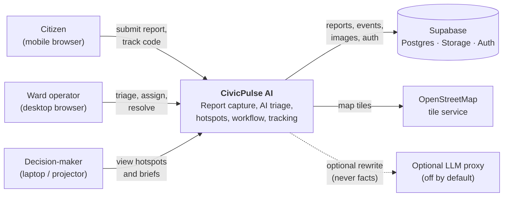

**External dependencies**

| System | Real or mocked | Purpose | Failure behaviour |
| --- | --- | --- | --- |
| Supabase | Real when configured | Persistence, images, auth, RLS | Fall back to local adapter |
| OpenStreetMap tiles | Real public service | Map background | Grey map; markers/lists still work |
| Optional LLM proxy | Off by default | Rewrite summaries | Keep deterministic summary |
| SMS/email/WhatsApp | **MOCKED** | Notifications | Nothing is sent; UI says so |
| Municipal CRM/311 | **MOCKED** | Dispatch | Brief is a recommendation only |

**Out of context:** payment, identity verification, field-crew GPS, GIS layers, weather, traffic.

---

## 5. Container view (C4 level 2)

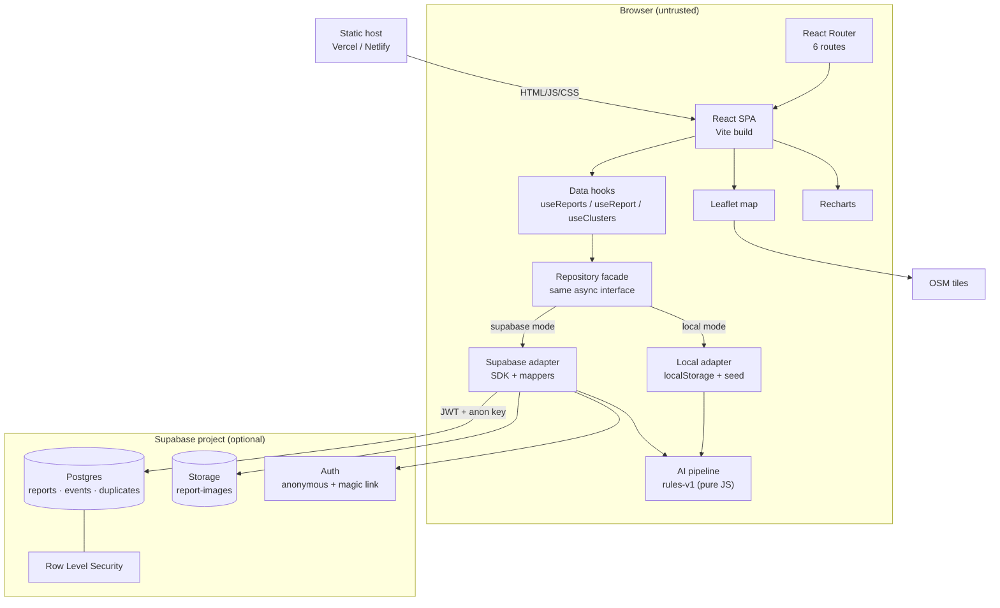

### 5.1 Container responsibilities

| Container | Technology | Responsibility | Does **not** do |
| --- | --- | --- | --- |
| React SPA | React 18, Vite 5 | Rendering, routing, form state, orchestration | Direct DB access, secrets |
| Router | react-router-dom 6 | URL ↔ page composition, nested layouts | Data fetching |
| Hooks | React hooks | Load/mutate via repository, expose loading/error | Business rules |
| Repository facade | Plain JS | Choose adapter; stable contract | Rendering |
| Local adapter | localStorage + seed | Offline demo persistence | Multi-user sync |
| Supabase adapter | supabase-js 2 | Real persistence, mapping snake↔camel | Business rules beyond mapping |
| AI pipeline | Pure JS | Classify, summarise, dedupe, cluster, prioritise | Network, rendering, persistence |
| Leaflet | leaflet 1.9 / react-leaflet 4 | Map, pins, hotspot circles | Geocoding, routing |
| Recharts | recharts 2 | Category, trend, priority charts | Data aggregation (done in pages/selectors) |
| Postgres | Supabase | Durable storage, constraints, RLS | AI computation (in MVP) |
| Storage | Supabase | Report images | Image analysis |
| Auth | Supabase | Anonymous citizens, operator magic link | Role assignment UI (manual) |

### 5.2 Why AI lives in the browser for the prototype

- **Time:** no function deploy, no cold starts, no CORS debugging.
- **Offline:** the demo works without network.
- **Explainability:** judges can open the file and read the exact scoring code.
- **Determinism:** same inputs, same outputs; no model version drift.
- **Cost:** zero API spend.

The trade-off is trust: a client can forge AI output. That is acceptable for synthetic demo data and is documented. The module boundary (`analyzeReport`) is the seam where a server-side implementation plugs in later.

---

## 6. Frontend architecture

### 6.1 Layering

```text
┌──────────────────────────────────────────────────────────────┐
│ app/            App, Router, providers, error boundary       │
├──────────────────────────────────────────────────────────────┤
│ pages/          Route composition + data orchestration       │
│                 Home, ReportIssue, Analysis, Dashboard,      │
│                 Admin, Track, NotFound                       │
├──────────────────────────────────────────────────────────────┤
│ components/     layout · ui · charts · map · reports         │
│                 Presentational, props in / events out        │
├──────────────────────────────────────────────────────────────┤
│ hooks/          useReports, useReport, useClusters, useToast │
├──────────────────────────────────────────────────────────────┤
│ services/       repository facade → adapters → AI pipeline   │
├──────────────────────────────────────────────────────────────┤
│ lib/            constants, env, geo, format, validation      │
│ data/           synthetic seed                               │
└──────────────────────────────────────────────────────────────┘
```

**Dependency rule:** arrows point downward only. A component may not import a page or a service. A hook may not import a component. `lib/` imports nothing from the app.

### 6.2 Route and layout tree

```text
BrowserRouter
└─ ToastProvider
   └─ Routes
      ├─ AppLayout (Header, Outlet, Footer, ToastViewport)
      │  ├─ "/"                    Home
      │  ├─ "/report"              ReportIssue
      │  ├─ "/analysis"            Analysis
      │  ├─ "/analysis/:id"        AnalysisDetail
      │  ├─ "/dashboard"           Dashboard
      │  ├─ "/track"               Track
      │  ├─ "/track/:code"         TrackDetail
      │  └─ "*"                    NotFound
      └─ AdminLayout (sidebar, top bar, Outlet)
         └─ "/admin"              Admin
```

| Layout | Used by | Composition |
| --- | --- | --- |
| `AppLayout` | Public/citizen pages | Sticky header, skip link, main landmark, footer, toast viewport |
| `AdminLayout` | `/admin` | Navy sidebar (desktop), mobile top bar + drawer, content area, back-to-site link |

### 6.3 Page composition

| Page | Sections | Data |
| --- | --- | --- |
| Home | Hero, stat strip, 4-step explainer, AI capability cards, hotspot preview, CTA | `useReports`, `useClusters` |
| ReportIssue | Form (description/category, map, evidence/contact), live AI hint, success navigation | `classifyReport`, `findDuplicateCandidates`, `createReport` |
| Analysis | Pipeline overview, latest report, recent table, model card | `useReports` |
| AnalysisDetail | Header, original report, summary, category, priority factors, duplicates, cluster | `useReport`, `useClusters` |
| Dashboard | KPIs, map + ranked list, charts, hotspot cards, brief modal | `useReports`, `useClusters` |
| Admin | Tabs: Queue, Duplicates, Hotspots, Reports; detail drawer | repository + mutations |
| Track | Code lookup + recent codes | `getReportByCode` |
| TrackDetail | Status hero, public timeline, summary card, honesty note | `getReportByCode`, `listEvents({publicOnly:true})` |

### 6.4 State management

No global store. State is classified and kept as local as possible.

| State type | Owner | Examples | Persistence |
| --- | --- | --- | --- |
| Server data | Data hooks | Reports, events, clusters | Repository |
| URL state | Router | `/analysis/:id`, `/track/:code`, dashboard filters | URL |
| Form state | Page/component | Description, category, pin, image | Component; draft in `sessionStorage` (optional) |
| UI state | Component | Modal open, tab, mobile menu, sort | Component |
| Cross-cutting | Context | Toasts, data-mode badge | Memory |
| Demo identity | Local storage (local mode) | "Demo Operator" | `civicpulse:v1:meta` |

**Why no Redux/Zustand:** the app has one primary dataset (reports) and one derived dataset (clusters). A repository + hook + refetch-on-mutation is simpler, easier to explain and sufficient at 42–500 records. Adding a store would create cache invalidation problems without solving a real one.

### 6.5 Data fetching lifecycle

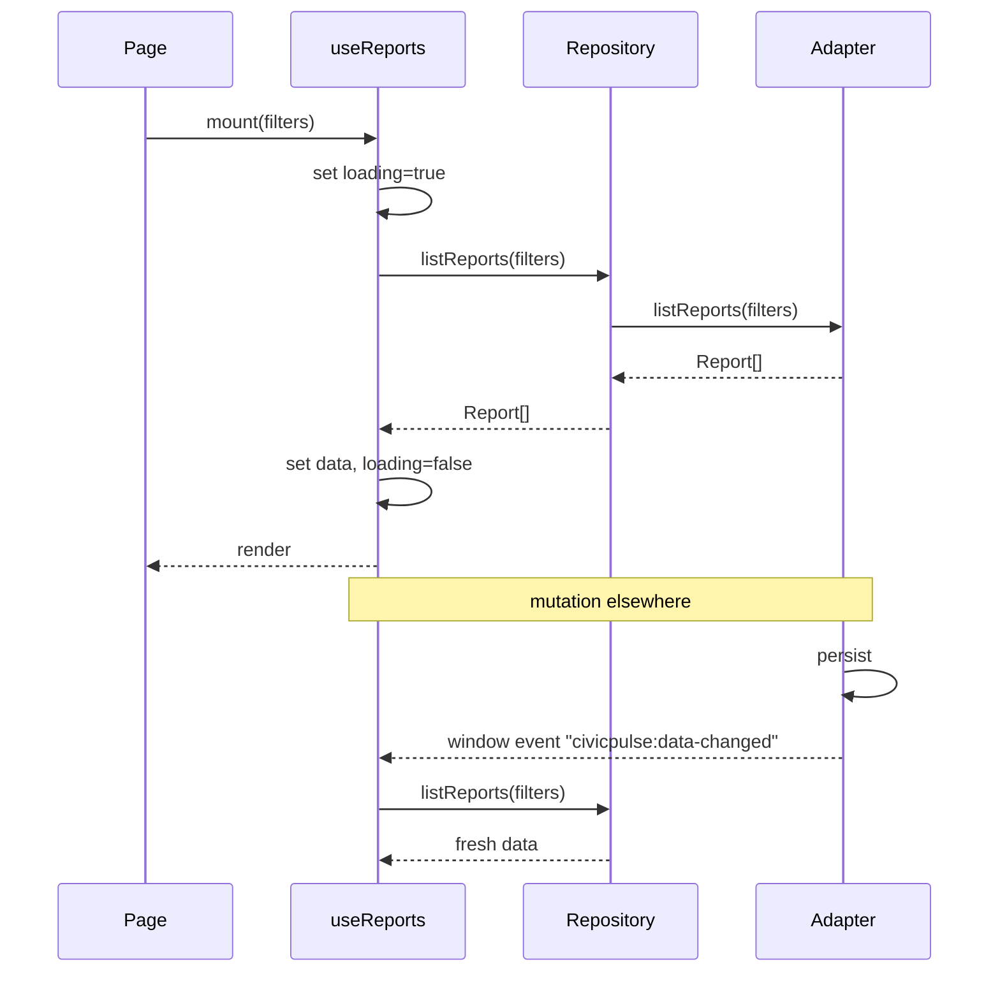

- Every hook exposes `{ data, loading, error, reload }`.
- Mutations dispatch `civicpulse:data-changed`; open hooks reload.
- There is no stale-while-revalidate cache; at demo scale a refetch is cheaper than explaining cache semantics.

### 6.6 Error boundaries

- A route-level `ErrorBoundary` catches render errors and shows "Something went wrong" with reload + home links.
- Async errors are caught in hooks/pages and rendered as retryable cards, not thrown.
- The boundary logs to the dev console only; no PII, no remote reporting.

### 6.7 Responsive composition

| Breakpoint | Navigation | Dashboard | Admin | Report form |
| --- | --- | --- | --- | --- |
| <640 | Hamburger drawer | 2-col KPI, stacked map/list/charts | Card list, drawer detail | Single column, sticky submit |
| 640–1023 | Inline nav if space, else drawer | 3-col KPI, map above list | Sidebar icon rail or drawer | Two columns begin |
| ≥1024 | Full inline nav | 8/4 map + list, 3 charts | Full sidebar + table | 7/5 split with live panel |
| ≥1280 | Full nav, wider container | 5-col KPI, wider charts | Full table + filters | Same, more breathing room |

### 6.8 Accessibility architecture

- Semantic landmarks (`header`, `nav`, `main`, `footer`) and one `h1` per page.
- Skip link before the header.
- Focus management in modals/drawers: trap, initial focus, restore on close.
- Map has a parallel list view; markers are not the only way to access reports.
- Status/priority always include text, never colour alone.
- `aria-live="polite"` region for toasts and submit results.

---

## 7. AI subsystem

### 7.1 Stage graph

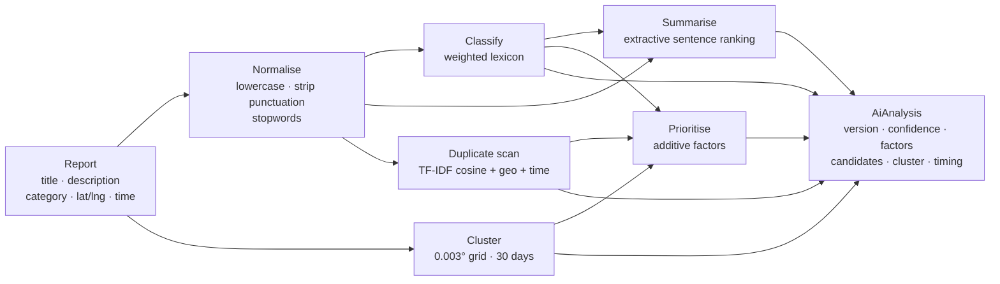

### 7.2 Module graph

```text
pipeline.js
├─ classify.js ──► normalize.js ──► constants.js (category labels)
├─ summarize.js ─► normalize.js, classify.js (lexicon)
├─ duplicates.js ► tfidf.js, geo.js, constants.js (families)
├─ clusters.js ──► geo.js, constants.js (cell size, window)
└─ priority.js ──► constants.js (base severity)
```

**Rules**

- `pipeline.js` is the only public entry point for pages/repositories.
- Individual modules are exported for unit tests.
- No module imports React, the repository or `window`.
- `now` is injected; no hidden clock reads.

### 7.3 Execution sequence

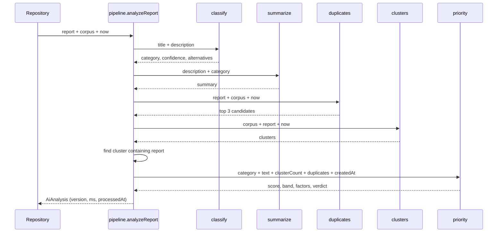

### 7.4 AI data contract

The pipeline returns a single JSON-serialisable object:

```js
{
  version: 'rules-v1',
  category, confidence, lowConfidence, alternatives, matchedTerms,
  summary,
  duplicates: [{ reportId, score, level, components, distanceMeters, ageDays, reasons }],
  priority: { score, band, factors: [{ code, label, points, detail }], verdict },
  cluster: { key, count, categories, avgPriority, hotspotScore, radiusMeters, trend } | null,
  processingMs, processedAt, deterministic
}
```

**Compatibility rule:** adding fields is allowed; renaming or removing fields requires bumping `AI_VERSION` and updating the UI + tests.

### 7.5 Explainability model

CivicPulse uses **local explanations**, not post-hoc approximations:

| Output | Explanation mechanism |
| --- | --- |
| Category | Matched lexicon terms + top-3 score shares |
| Summary | Extractive: every phrase exists in the input |
| Duplicate | Four weighted components shown separately |
| Priority | Additive factors whose points sum to the score |
| Cluster | Cell key, member count, radius, category mix, trend |
| Brief | Template populated only from cluster fields |

This is stronger than a SHAP-style explanation of a black box: the model *is* the explanation. The limitation is model simplicity, which is stated openly.

### 7.6 Determinism and versioning

- Stable sort tie-breakers: category key alphabetically, duplicate score then report id.
- No random sampling, no temperature, no model calls.
- `AI_VERSION = 'rules-v1'` is stored on every report (`ai.version`, `ai_version`).
- `processingMs` is the only varying field and is excluded from determinism tests.
- If weights change, bump to `rules-v2` and keep old reports readable (the UI reads fields defensively).

### 7.7 AI evolution path

| Stage | Now (hackathon) | Next | At city scale |
| --- | --- | --- | --- |
| Execution | Browser, synchronous | Supabase Edge Function on insert | Queue + worker pool |
| Classification | Lexicon | Multilingual embeddings + few-shot LLM | Fine-tuned classifier with human labels |
| Duplicates | TF-IDF + geo + time | pgvector embeddings + geo prefilter | ANN index + active learning |
| Clusters | Grid cells | PostGIS `ST_ClusterDBSCAN` | Spatiotemporal DBSCAN + seasonality |
| Priority | Additive expert weights | Calibrated against outcomes | Learned ranking with fairness constraints |
| Summary | Extractive | Constrained LLM rewrite | LLM + template guardrails |
| Images | None | Vision triage with human review | Multi-modal pipeline |
| Explainability | Factor table | Same + counterfactuals | Model cards + audit logs |

The repository and `analyzeReport` contracts are the seams that make this evolution incremental.

---

## 8. Data architecture

### 8.1 Entity-relationship diagram

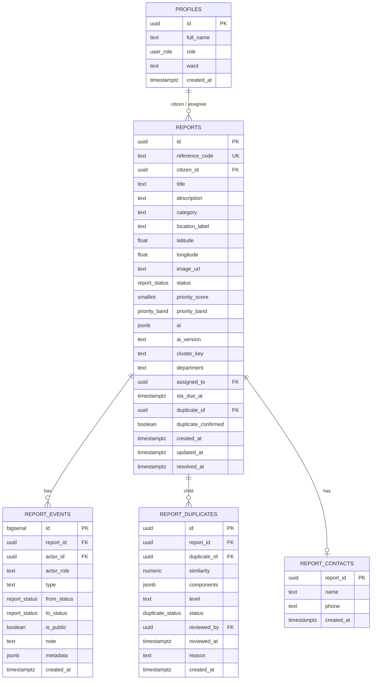

### 8.2 Entity responsibilities

| Entity | Responsibility | Invariants |
| --- | --- | --- |
| `profiles` | Role and ward for a user | One row per `auth.users` row; role ∈ citizen/operator/admin |
| `reports` | Current state of a complaint + latest AI output | Unique reference code; description length 20–1000; valid coordinates; band consistent with score |
| `report_events` | Append-only audit/timeline | Never updated or deleted; public flag controls citizen visibility |
| `report_duplicates` | Candidate link awaiting review | Unique pair; no self-link; status pending/confirmed/rejected |
| `report_contacts` | Optional PII, isolated | Only owner or staff can read |

### 8.3 Why AI lives on `reports` (JSONB) rather than a separate table

**Decision:** store the full `AiAnalysis` in `reports.ai` and denormalise `priority_score`, `priority_band`, `cluster_key`.

**Benefits**

- One read returns everything the analysis page needs.
- Queue sorting uses indexed columns, not JSON extraction.
- No join or N+1 in the demo.

**Costs**

- Re-analysis must update two representations.
- No history of previous model runs.
- JSON schema drift is possible.

**Mitigation**

- `ai_version` column; UI reads defensively with fallbacks.
- A future `report_analysis` table can be added without breaking the UI if the repository maps the latest run into `report.ai`.

### 8.4 Local storage layout (demo mode)

| Key | Value | Reset |
| --- | --- | --- |
| `civicpulse:v1:reports` | Array of `Report` | Deleted by "Reset demo data" |
| `civicpulse:v1:events` | Array of `ReportEvent` | Same |
| `civicpulse:v1:duplicates` | Array of `DuplicatePair` | Same |
| `civicpulse:v1:meta` | `{ seeded, seededAt, version }` | Same |

- Schema version is embedded in the key (`v1`). A future breaking change uses `v2` and a migration function.
- Quota: 5–10 MB per origin. Images are downscaled; only small data URLs are stored. If quota is exceeded, the adapter catches `QuotaExceededError` and returns a clear message ("Demo storage is full — reset demo data").
- Cross-tab updates: the adapter dispatches a `window` event after writes; other tabs reload on focus.

### 8.5 Seed data pipeline

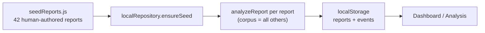

**Rules**

- Human-authored fields: description, category, location, timestamps, status.
- Machine-derived fields: AI JSON, priority score/band, cluster key.
- The seed is analysed in a **second pass** with the full corpus so duplicate candidates and clusters are real.
- Seed composition matches PRD §12: 8 duplicate groups, 3 P0s, 2 clusters, 30-day spread.
- No real personal data; no remote images.

### 8.6 Data consistency rules

| Rule | Enforcement |
| --- | --- |
| `priority_band` matches `priority_score` | Pipeline derives band; UI/test asserts |
| Factor points sum to score | Pipeline construction + unit test |
| `cluster_key` matches current cell | Recomputed on analysis; dashboard recomputes clusters live |
| `duplicate_of` never self | DB check + service guard |
| Events are append-only | No update/delete paths in the app |
| `resolved_at` set iff resolved/closed | Service sets on transition |
| `reference_code` unique | DB unique constraint + retry |
| Public timeline excludes internal notes | `is_public` filter in query |

### 8.7 Retention and privacy

- Prototype data is synthetic; no retention policy is enforced.
- Local mode: data lives until the user resets or clears the browser.
- Supabase mode: rows persist until manually deleted.
- PII (optional contact) is isolated and never rendered publicly.
- Production needs: retention schedule, deletion requests, audit access logs, encryption at rest (Supabase default), DPA.

---

## 9. Key data flows

### 9.1 Report submission and AI analysis (local mode)

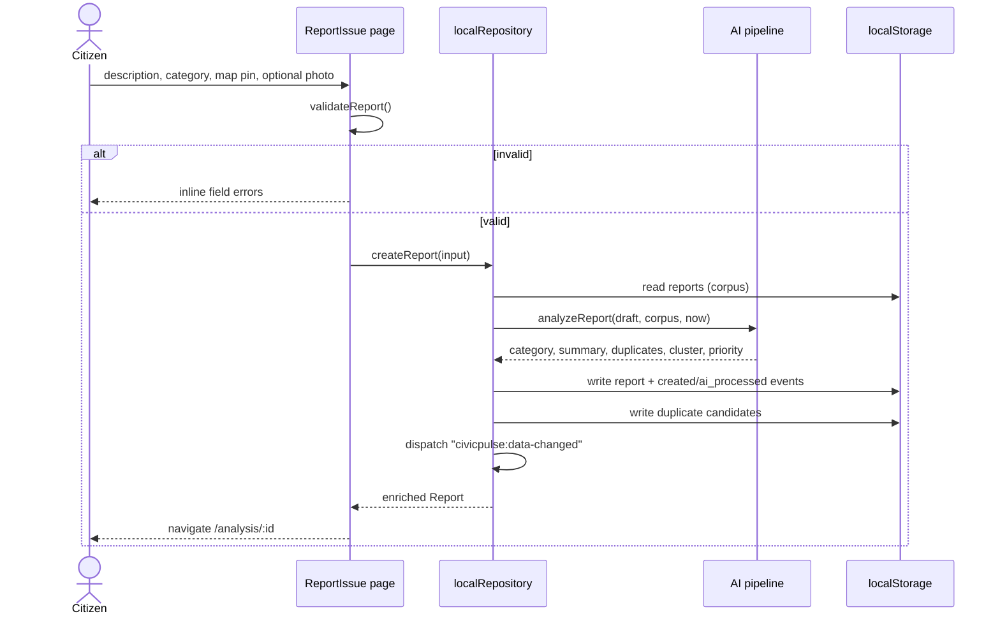

**Failure handling**

- Validation fails → no write, form preserved, first invalid field focused.
- `localStorage` quota → catch, show "Demo storage is full — reset demo data", do not navigate.
- AI throws (should not, pure functions) → report is still saved with `ai: null` and an `ai_failed` event; UI shows "Analysis pending".

### 9.2 Report submission (Supabase mode)

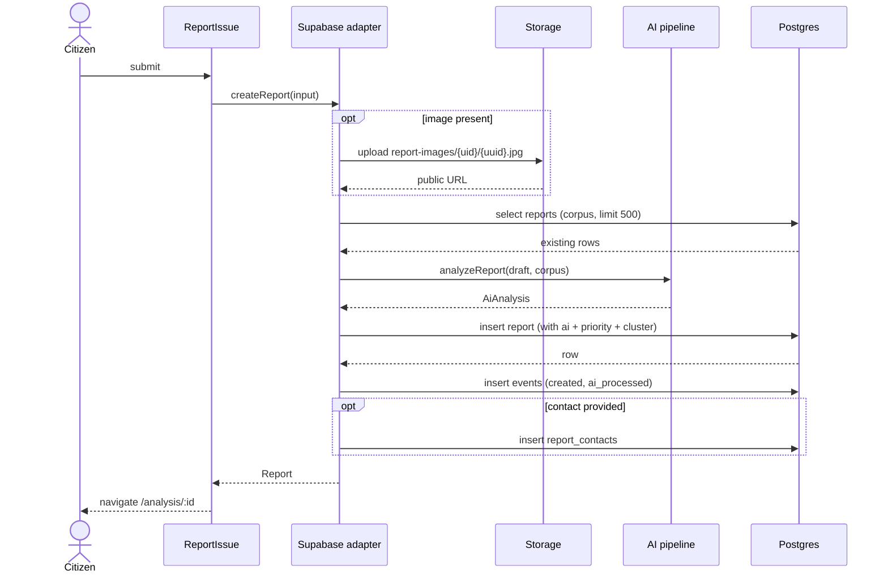

**Trust note:** the client computes AI before insert. A production system would insert first, then trigger an Edge Function that computes and updates the row, with the client polling or subscribing. The UI contract would not change.

### 9.3 Duplicate review and merge

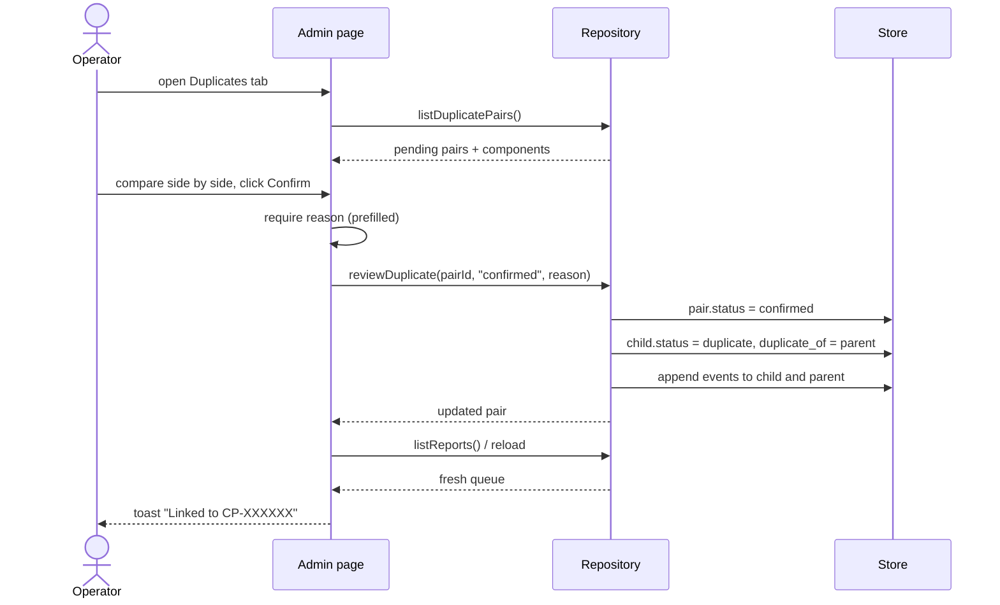

**Merge semantics**

- The child report is **not deleted**; it becomes a pointer with its own history.
- The parent gains a corroboration event and, on the next analysis, duplicate corroboration points.
- Confirmed duplicates are excluded from cluster counts and duplicate scans.
- Rejecting a pair leaves both reports independent and records the decision.

### 9.4 Dashboard and hotspot brief

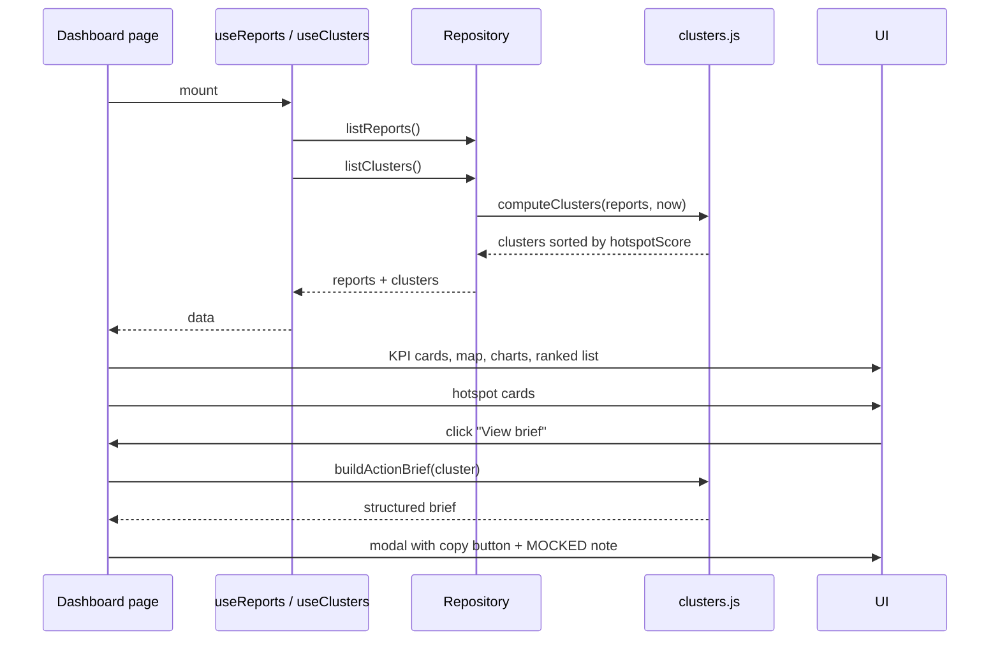

**Consistency:** KPIs, map markers, charts and the ranked list all derive from the same `reports` array in one render pass. Filters are applied once at the page level, then passed down. This prevents the classic dashboard bug where the map and the KPI disagree.

### 9.5 Status update and citizen tracking

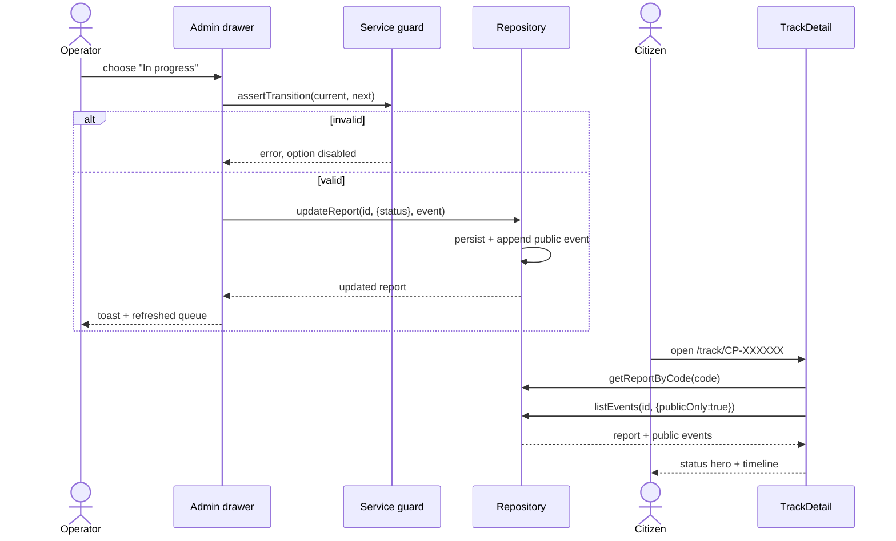

**Visibility:** internal notes (`is_public=false`) never reach the public query. The citizen sees role labels ("Ward operator"), not personal names.

### 9.6 Pre-submit duplicate warning (optional enhancement)

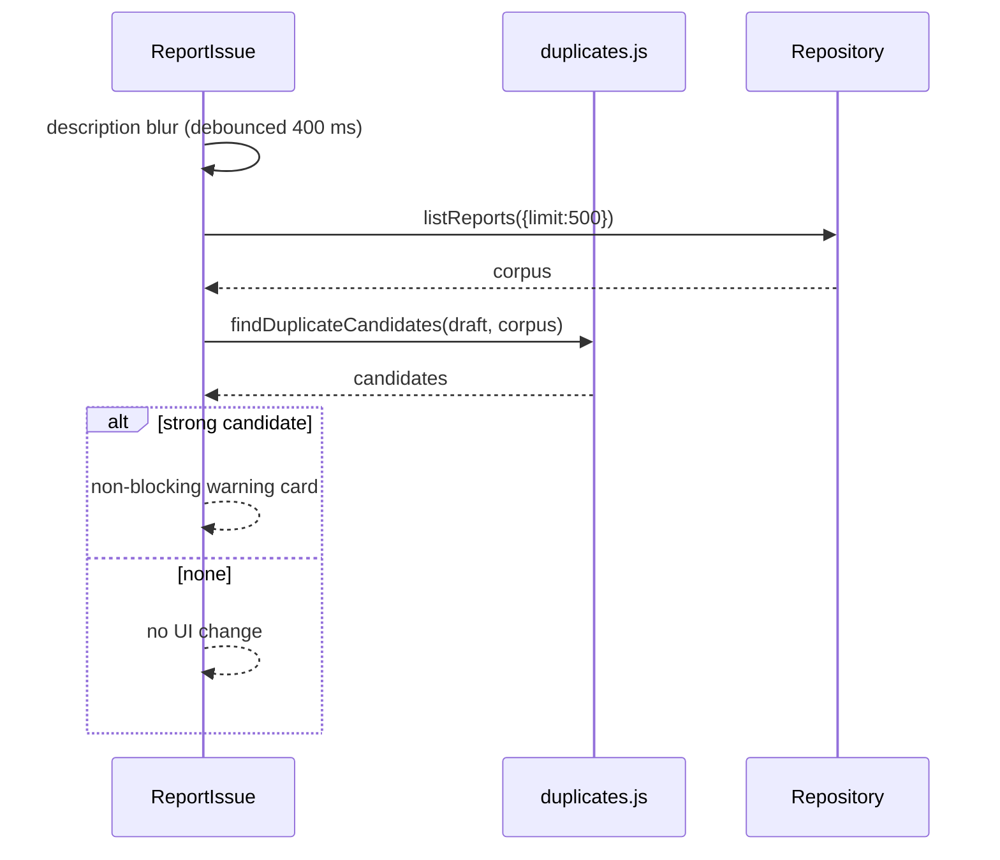

This is a **should-have**, not a must. It must never block submission; a citizen may legitimately report a recurring issue again.

---

## 10. Security architecture

### 10.1 Trust boundaries

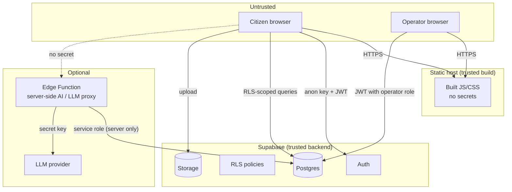

**Rules**

- The browser is untrusted. Client-side route guards are UX, not security.
- The anon key is public; RLS is the enforcement point.
- The service role key exists only in a server/CLI environment, never in `VITE_*`.
- AI output from the client is advisory; a production system recomputes it server-side.

### 10.2 Authentication and authorisation flows

| Persona | Local mode | Supabase mode |
| --- | --- | --- |
| Citizen | No login; local anonymous identity | `signInAnonymously()`; `citizen_id = auth.uid()` |
| Operator | "Demo Operator" badge; all actions enabled | Magic link; `profiles.role = 'operator'` |
| Admin | Same as operator | `profiles.role = 'admin'`; all operator rights |
| Public viewer | Full read of demo data | Read of reports and public events |

**Role assignment:** manual SQL in the prototype (`update profiles set role='operator' where id='…'`). A production system needs an invite flow and audit.

### 10.3 RLS policy matrix

| Table / action | Anon | Authenticated citizen | Operator | Admin | Service role |
| --- | --- | --- | --- | --- | --- |
| `profiles` select own | — | ✅ own | ✅ all | ✅ all | ✅ |
| `profiles` update own | — | ✅ (role immutable via policy) | ✅ own | ✅ own | ✅ |
| `reports` select | ✅ public | ✅ public | ✅ | ✅ | ✅ |
| `reports` insert | ✅ if `citizen_id` null | ✅ own | ✅ | ✅ | ✅ |
| `reports` update | — | — | ✅ | ✅ | ✅ |
| `report_events` select | ✅ public only | ✅ public only | ✅ all | ✅ all | ✅ |
| `report_events` insert | — | ✅ `created` for own report | ✅ | ✅ | ✅ |
| `report_duplicates` select | — | — | ✅ | ✅ | ✅ |
| `report_duplicates` write | — | — | ✅ | ✅ | ✅ |
| `report_contacts` select | — | ✅ own | ✅ | ✅ | ✅ |
| `report_contacts` insert | — | ✅ own report | ✅ | ✅ | ✅ |
| Storage read | ✅ public bucket | ✅ | ✅ | ✅ | ✅ |
| Storage write | — | ✅ authenticated | ✅ | ✅ | ✅ |

**Known prototype compromise:** public read on `reports` enables the dashboard without login. No PII is stored there. Production would expose an aggregated public view and restrict raw rows.

### 10.4 Threat model (STRIDE, scoped to prototype)

| Threat | Example | Control | Residual risk |
| --- | --- | --- | --- |
| **Spoofing** | Fake operator account | Magic link + role in `profiles`; RLS | Role assignment is manual |
| **Tampering** | Citizen edits another report | RLS update restricted to staff | Client-computed AI can be forged (demo) |
| **Repudiation** | Operator denies status change | Append-only events with actor id/role | No signed audit log |
| **Information disclosure** | Phone number exposed | PII isolated in `report_contacts`; RLS | Reports are public in prototype |
| **Denial of service** | Spam submissions | Supabase rate limits; no CAPTCHA | Not hardened |
| **Elevation of privilege** | Citizen sets `role='admin'` | Policy prevents role change; `is_staff()` checks DB | Manual review of policies required |
| **XSS** | Malicious description | React escapes; no raw HTML | Third-party script compromise (none) |
| **Malicious upload** | SVG with script | MIME allowlist, reject SVG, size cap | Public bucket; no AV scan |
| **CSV injection** | `=cmd` in export | Prefix formula characters | Client-side only |
| **Code enumeration** | Guess tracking codes | 32^6 space; rate limits | No per-code rate limit in MVP |

### 10.5 Secrets and configuration

| Secret | Where | Exposure |
| --- | --- | --- |
| `VITE_SUPABASE_URL` | `.env.local` / host env | Public (fine) |
| `VITE_SUPABASE_ANON_KEY` | `.env.local` / host env | Public (RLS-protected) |
| `SUPABASE_SERVICE_ROLE_KEY` | CLI/scripts only | **Never** client, never committed |
| LLM provider key | Edge Function env | Server only |
| `VITE_AI_PROXY_URL` | Client env | Public endpoint, auth via Supabase JWT |

### 10.6 Privacy by design

- Synthetic data only; no real names, phone numbers or addresses.
- Contact fields optional and never rendered on public pages.
- Tracking requires a code, not a name or phone.
- Photos are labelled evidence-only; no face recognition or vision model.
- No analytics or third-party trackers.
- Logs contain IDs and timings, not descriptions or contacts.

---

## 11. Deployment topology

### 11.1 Local development

```text
Developer machine
├─ Vite dev server (localhost:5173)
├─ Local adapter (localStorage) ── default
└─ Optional: Supabase project (remote)
```

```bash
npm install
npm run dev
```

No Docker, no local Postgres, no server process. This is deliberate: one command must bring the demo up.

### 11.2 Hosted prototype

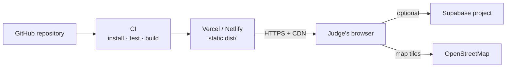

| Component | Provider | Configuration |
| --- | --- | --- |
| Static hosting | Vercel or Netlify | Build `npm run build`, output `dist`, SPA rewrite |
| Database/Auth/Storage | Supabase | Schema SQL, anon key, RLS, bucket |
| Map tiles | OpenStreetMap | No key; attribution required |
| Fonts | Google Fonts | Optional; system fallback |
| LLM | Supabase Edge Function (optional) | Off by default |

### 11.3 Environment matrix

| Variable | Local demo | Hosted demo | Supabase mode |
| --- | --- | --- | --- |
| `VITE_DATA_MODE` | `local` | `local` or `auto` | `supabase` |
| `VITE_SUPABASE_URL` | empty | empty or set | set |
| `VITE_SUPABASE_ANON_KEY` | empty | empty or set | set |
| `VITE_DEMO_CENTER_*` | demo coords | demo coords | demo coords |
| `VITE_AI_LLM_ENABLED` | `false` | `false` | `false` |

**Rule:** the hosted demo must work with **no** Supabase env. If credentials are present, the banner changes to "Connected to Supabase"; otherwise "Demo mode — local data". The demo script explicitly says which mode is running.

### 11.4 CI pipeline (optional, recommended)

`.github/workflows/ci.yml`:

```yaml
name: ci
on:
  push:
    branches: [main]
  pull_request:

jobs:
  build:
    runs-on: ubuntu-latest
    steps:
      - uses: actions/checkout@v4
      - uses: actions/setup-node@v4
        with:
          node-version: 20
          cache: npm
      - run: npm ci
      - run: npm run lint
      - run: npm run test
      - run: npm run build
```

No secrets are required for CI because tests run against pure functions and local mode.

### 11.5 Release and rollback

| Step | Action |
| --- | --- |
| Release | Tag `v0.1.0-hackathon`; deploy `dist` |
| Rollback (host) | Promote previous deployment in Vercel/Netlify |
| Rollback (data mode) | Set `VITE_DATA_MODE=local`, redeploy/restart |
| Data reset | Local: footer button; Supabase: SQL truncate (demo only) |

---

## 12. Reliability and failure modes

### 12.1 Failure matrix

| Failure | Detection | User-visible behaviour | Recovery |
| --- | --- | --- | --- |
| Supabase env missing | `env.js` resolution | Banner "Supabase not configured — local demo data" | Use local mode |
| Supabase unreachable | SDK error | Error card + retry; form preserved | Retry or switch mode |
| RLS denies write | Postgres `42501` | "You do not have permission" toast | Sign in with correct role |
| localStorage quota | `QuotaExceededError` | "Demo storage is full — reset demo data" | Reset seed |
| Corrupt localStorage JSON | `JSON.parse` throws | Adapter falls back to seed + warning | Auto-reseed |
| Map tiles blocked | Tile errors | Grey map, pins/circles still render | List view works |
| AI module throws | try/catch around `analyzeReport` | Report saved with `ai: null`, "Analysis pending" | Admin re-analyse |
| Unknown tracking code | Repository returns null | Friendly empty state | Re-enter code |
| Invalid status transition | Guard | Option disabled + tooltip | Choose a valid next state |
| Duplicate merge conflict | Unique constraint | Toast "Already linked" | Refresh queue |
| Image too large | Client validation | Inline error | Choose smaller image |
| LLM proxy down | Fetch rejects/timeout | Deterministic summary remains | None needed |
| Clock skew | Recency odd | Priority still valid; timestamp shown | Not critical |

### 12.2 Degraded modes

| Mode | What still works | What degrades |
| --- | --- | --- |
| Offline, local data | Submit, AI, dashboard (cached data), admin, tracking | Map tiles, fonts |
| Supabase down | Nothing new persists | Read-only cached page state; switch to local |
| No JS | Nothing (SPA) | Documented limitation |
| Small screen | Full citizen flow | Tables become cards; charts scroll vertically |
| Low-end device | Full flow | Map interactions slower; charts static |

### 12.3 Data durability

- **Local mode:** browser storage only; clearing site data loses reports. The seed can be restored.
- **Supabase mode:** Postgres durability; no backups configured in the free tier beyond provider defaults.
- **Demo discipline:** run the script once, reset, run again. Do not rely on data surviving a browser profile change.

### 12.4 Idempotency and concurrency

- Submitting twice creates two reports; the duplicate detector links them. No idempotency key in MVP.
- Concurrent operators editing the same report: last write wins; events preserve history. No optimistic locking.
- Cluster computation is read-only and safe to run concurrently.
- Duplicate confirmation is guarded by a unique pair constraint.

These are acceptable for a single-operator demo and listed as production gaps.

---

## 13. Performance and scalability

### 13.1 Current capacity

| Dimension | Demo target | Hard limit before redesign |
| --- | --- | --- |
| Reports | 42 seeded + ~10 live | ~500 in-browser |
| Events | ~200 | ~5,000 |
| Duplicate candidates per report | 3 shown | Corpus scan O(n) |
| Clusters | 2–6 | ~50 cells |
| Concurrent users | 1–3 | Supabase free tier |
| Map markers | 50 | ~500 before clustering markers |
| Bundle | ≤350 KB gzip | Lazy routes if exceeded |

### 13.2 Bottleneck analysis

| Operation | Complexity | Measured/expected | Mitigation |
| --- | --- | --- | --- |
| TF-IDF build | O(n × tokens) | ~2–15 ms at 42; <150 ms at 500 | Cache index per corpus version |
| Duplicate scan | O(n) cosine | <10 ms at 42 | Geo prefilter (already) |
| Cluster build | O(n) | <5 ms | Grid map |
| Recharts render | O(series) | 20–60 ms | Fewer points, no animation |
| Leaflet markers | O(n) DOM | 50 markers fine | Marker clustering at 500+ |
| localStorage read/write | O(n) JSON | <10 ms at 42 | Debounce writes; IndexedDB later |
| Initial bundle | — | Leaflet + Recharts dominate | Route-level lazy loading |

### 13.3 Evolution phases

**Phase 0 — Hackathon (current design)**

- Static SPA, local/Supabase adapter, browser AI, grid clusters, manual workflow.

**Phase 1 — Hardening (2–4 weeks)**

- Move AI to a Supabase Edge Function triggered on insert.
- Enforce server-side validation and recomputation of AI fields.
- Tighten RLS: public aggregated view instead of raw reports.
- Add operator invites, audit log, rate limiting, CAPTCHA.
- Add pgvector embeddings for duplicate candidates; keep TF-IDF as fallback.
- Add Playwright E2E for the five-minute journey.

**Phase 2 — City scale (2–3 months)**

- PostGIS + `ST_ClusterDBSCAN`; spatial indexes.
- Queue (pgmq/SQS) + workers for AI and notifications.
- Materialised views for dashboard aggregates; incremental refresh.
- Object storage lifecycle + image moderation.
- Real notification adapters (email/SMS/WhatsApp) with consent.
- SLA automation and escalation.
- Multi-ward/multi-city tenancy with row-level scoping.

**Phase 3 — Operations (6+ months)**

- Learned priority calibration against outcomes; fairness monitoring.
- Predictive hotspot forecasting (seasonality, weather).
- Field-crew app and GPS verification.
- Public API and open data portal.
- Audit-grade retention and FOI workflows.

### 13.4 Scale-up seams

```text
Repository interface ──► swap local for Supabase (already done)
analyzeReport() ───────► move to Edge Function unchanged
textSimilarity() ──────► swap TF-IDF for embeddings
computeClusters() ─────► swap grid for PostGIS RPC
reports.ai JSONB ──────► add report_analysis history table
events ────────────────► add outbox/queue for notifications
```

Every seam is a function or interface, not a UI concern. That is the main architectural bet: **the demo UI should survive the production rewrite.**

---

## 14. Observability

### 14.1 What is logged

| Event | Where | Fields |
| --- | --- | --- |
| AI run | Console (dev), stored in `ai` | version, category, confidence, score, band, ms |
| Repository error | Console (dev) + toast | operation, code, message (no description/PII) |
| Mutation | Console (dev) | report id, from/to status, actor role |
| Mode resolution | Console (dev) | `local` / `supabase`, reason |

### 14.2 What is displayed

- `AI rules-v1 · 14 ms · deterministic` on the analysis page.
- Data-mode badge in the footer/header.
- Seed count and "synthetic data" note on the dashboard.
- Confidence and low-confidence warning.
- `MOCKED` labels on notifications and dispatch.

### 14.3 What is intentionally absent

- No Sentry/Datadog/analytics.
- No PII in logs.
- No remote logging endpoint (would be a fake integration if invented).
- No dashboards for infrastructure.

Production would add structured logs, traces around the AI function, error tracking with PII scrubbing, and alerting on P0 acknowledgement SLA.

---

## 15. Architecture decision records

### ADR-001 — Deterministic rules AI instead of an LLM-first pipeline

- **Status:** Accepted
- **Context:** 8-hour solo build; judges reward working, explainable AI; API keys and latency are risks.
- **Decision:** Implement classification, summarisation, duplicate detection, clustering and prioritisation as deterministic JS heuristics.
- **Alternatives:** LLM API for everything; classical ML training; no AI.
- **Consequences:** Fully offline, fast, inspectable, reproducible. Weaker language understanding. LLM is an optional, off-by-default adapter.

### ADR-002 — Local-first repository with a Supabase adapter

- **Status:** Accepted
- **Context:** Demo reliability matters more than multi-user persistence; Supabase setup can fail.
- **Decision:** Define one async repository interface; default to localStorage + seed; opt into Supabase via env.
- **Alternatives:** Supabase-only; mock JSON imports; custom Node API.
- **Consequences:** Demo works offline; two adapters to maintain; local mode is single-browser. The honesty banner makes the mode explicit.

### ADR-003 — TF-IDF cosine for duplicate detection

- **Status:** Accepted
- **Context:** Need explainable, dependency-free similarity at 42–500 reports.
- **Decision:** TF-IDF vectors + cosine, combined with category, haversine distance and time decay.
- **Alternatives:** Sentence embeddings; LLM comparison; Jaccard only.
- **Consequences:** Fast, deterministic, shows shared terms. Misses paraphrase; thresholds tuned on synthetic data. `textSimilarity` is the swap seam for embeddings.

### ADR-004 — Grid clustering instead of DBSCAN

- **Status:** Accepted
- **Context:** No PostGIS; clustering must run in the browser and be explainable.
- **Decision:** Bucket coordinates into 0.003° cells, require ≥3 reports in 30 days, compute centroid/radius/hotspot score.
- **Alternatives:** DBSCAN in JS; k-means; manual hotspot list.
- **Consequences:** O(n), trivial to explain, no tuning. Cell-boundary splits and dense-area merging are possible and documented.

### ADR-005 — Human-confirmed duplicate merges

- **Status:** Accepted
- **Context:** False merges hide real issues and embarrass the demo.
- **Decision:** AI only suggests; an operator confirms/rejects with a reason.
- **Alternatives:** Auto-merge above threshold; no merge.
- **Consequences:** Safer, auditable, adds a workflow step. Corroboration points only accrue after confirmation.

### ADR-006 — AI payload in `reports.ai` JSONB

- **Status:** Accepted
- **Context:** Need the full explanation without joins; dashboard needs fast sorting.
- **Decision:** Store the full object in JSONB and denormalise score/band/cluster key.
- **Alternatives:** Normalised `report_analysis` table; separate document store.
- **Consequences:** One-read analysis page; duplication; no history. A future history table can be added behind the repository.

### ADR-007 — No global state library

- **Status:** Accepted
- **Context:** One dataset, small scale, solo developer.
- **Decision:** Hooks + repository + refetch-on-mutation; context only for toasts/mode.
- **Alternatives:** Redux, Zustand, TanStack Query.
- **Consequences:** Less abstraction, fewer bugs, easy to explain. More refetches; fine at demo scale. If the app grows, TanStack Query is the natural upgrade.

### ADR-008 — Tailwind tokens instead of a component library

- **Status:** Accepted
- **Context:** Need a distinctive navy/white/teal civic identity in hours.
- **Decision:** Tailwind with custom tokens and a small in-house component set.
- **Alternatives:** MUI, Chakra, shadcn/ui, Bootstrap.
- **Consequences:** Full visual control and no dependency weight; we own accessibility details. More component code to write.

### ADR-009 — OpenStreetMap tiles

- **Status:** Accepted
- **Context:** No billing account or API key; map is essential for capture and hotspots.
- **Decision:** Leaflet + OSM standard tiles with attribution.
- **Alternatives:** Mapbox, Google Maps, MapLibre + free vector tiles.
- **Consequences:** Free and keyless; tile usage policy limits production scale; offline shows a grey map. Production should use a paid or self-hosted tile provider.

### ADR-010 — Tracking code as the public identifier

- **Status:** Accepted
- **Context:** Citizens should track without an account; demo needs a simple lookup.
- **Decision:** `CP-XXXXXX` from a 32-symbol alphabet, unique constraint, case-insensitive lookup.
- **Alternatives:** Email magic link; phone OTP; UUID in URL.
- **Consequences:** Frictionless and demo-friendly; enumerable in principle; no per-code rate limit yet. Production adds throttling and optional contact verification.

### ADR-011 — Public read on reports in the prototype

- **Status:** Accepted (prototype only)
- **Context:** Dashboard must work without login; data is synthetic.
- **Decision:** Allow `select` on `reports`; isolate PII in `report_contacts`.
- **Alternatives:** Anonymous auth for all reads; aggregated public view.
- **Consequences:** Simple demo, but raw rows are exposed. Production must replace with an aggregated view or authenticated access. Documented in limitations.

### ADR-012 — No image AI

- **Status:** Accepted
- **Context:** Vision models add cost, latency, keys and failure modes; the brief allows text and/or image.
- **Decision:** Store photos as evidence; label "not analysed".
- **Alternatives:** Vision API for category hints; local CLIP.
- **Consequences:** Honest scope; less impressive multimodal demo. Photo still improves citizen trust and operator context.

### ADR-013 — Client-side AI before insert (Supabase mode)

- **Status:** Accepted (prototype), superseded by Edge Function in production
- **Context:** No server code in the 8-hour scope.
- **Decision:** Compute AI in the browser, then insert the complete row.
- **Alternatives:** Insert first + DB trigger; Edge Function before insert.
- **Consequences:** Simple and fast; AI fields are forgeable. Production recomputes server-side.

### ADR-014 — English-first copy and lexicon

- **Status:** Accepted
- **Context:** Demo audience and timebox.
- **Decision:** English UI and lexicon, with a documented multilingual gap.
- **Alternatives:** Hindi/Kannada first; translation layer.
- **Consequences:** Clear demo; real wards are multilingual. Embeddings + translation are the next step.

---

## 16. Risks and trade-offs

### 16.1 Architectural risks

| Risk | Likelihood | Impact | Mitigation | Trigger to revisit |
| --- | --- | --- | --- | --- |
| Browser AI is not trusted | Medium | Medium | Documented; server recompute planned | Any real deployment |
| Public report reads leak data | Low (synthetic) | High (production) | PII isolated; RLS documented | Real citizen data |
| Grid clusters split hotspots | High | Medium | Radius shown; boundary note; list view | Users report misses |
| TF-IDF misses paraphrases | High | Medium | Conservative thresholds; human review | Duplicate recall < target |
| Priority weights misrank | Medium | High | Factor transparency; operator override | Override rate > 20% |
| localStorage quota | Low | Medium | Downscale images; reset; IndexedDB later | >100 reports locally |
| Leaflet bundle size | Medium | Low | Lazy routes if needed | Initial JS > 350 KB |
| Supabase RLS misconfiguration | Medium | High | Policy matrix + manual tests | Before any public deploy |
| Timebox forces cuts | High | Medium | Cut order in PRD; must-haves fixed | Hour 6 checkpoint |

### 16.2 Trade-off summary

| We chose | Over | Because |
| --- | --- | --- |
| Deterministic heuristics | LLM-first | Offline, explainable, no key, deterministic demo |
| Local-first | Cloud-only | Stage reliability |
| Human-confirmed merges | Auto-merge | Avoid hiding real issues |
| Grid cells | DBSCAN | Simplicity and explainability in the timebox |
| JSONB AI payload | Normalised history | Read speed and build speed |
| Public read (prototype) | Auth wall | Dashboard access without login; synthetic data |
| OSM tiles | Paid maps | No key/billing |
| In-house components | UI kit | Brand control and small bundle |

---

## 17. Folder-to-architecture map

| Folder | Architectural role | Key rule |
| --- | --- | --- |
| `src/app/` | Composition root | Router + providers only |
| `src/pages/` | Route orchestration | May use hooks/services; no direct DB |
| `src/components/layout/` | Shells | No data fetching |
| `src/components/ui/` | Design system primitives | Props in, events out |
| `src/components/charts/` | Visualisation | Receive prepared series |
| `src/components/map/` | Geospatial rendering | Leaflet isolated here |
| `src/components/reports/` | Domain presentation | Receive `Report`/`AiAnalysis` |
| `src/hooks/` | Data/UI state | Repository calls only here |
| `src/services/ai/` | AI core | Pure, no React, no network |
| `src/services/local/` | Demo adapter | localStorage only |
| `src/services/supabase/` | Real adapter | SDK + mapping only |
| `src/lib/` | Cross-cutting utilities | No app imports |
| `src/data/` | Seed content | Human-authored facts only |
| `src/types/` | JSDoc contracts | No runtime exports |
| `supabase/` | Schema and seed SQL | Applied manually/CLI |
| `scripts/` | Seed evaluation | Dev-only |

---

## 18. Glossary

| Term | Meaning |
| --- | --- |
| **AI pipeline** | The `analyzeReport` sequence: classify → summarise → duplicates → cluster → priority |
| **Adapter** | A repository implementation for local storage or Supabase |
| **Band** | P0–P3 priority grouping derived from score |
| **Brief** | Template-generated action recommendation for a hotspot |
| **Cluster / hotspot** | ≥3 related reports in a ~330 m grid cell within 30 days |
| **Corroboration** | Confirmed duplicates that increase impact/confidence |
| **Demo mode** | Local adapter using seeded data, labelled in the UI |
| **Deterministic** | Same input + corpus + clock → same output |
| **Duplicate candidate** | A report above the similarity floor, awaiting human review |
| **Event** | Append-only workflow log entry |
| **Hotspot score** | 0–100 blend of volume, category diversity and average priority |
| **Model card** | The in-app explanation of version, method and limits |
| **Reference/tracking code** | Public identifier `CP-XXXXXX` |
| **RLS** | Postgres Row Level Security |
| **`rules-v1`** | Version tag of the deterministic AI pipeline |
| **Seam** | A function/interface where a production component can replace the prototype one |

---

## Appendix A — Request lifecycle at a glance

```text
Citizen
  └─ POST-like createReport
       ├─ validate
       ├─ analyze (AI)
       ├─ persist report + events + duplicate candidates
       └─ return tracking code

Operator
  ├─ list queue (priority sorted)
  ├─ review AI factors
  ├─ confirm/reject duplicates
  ├─ assign department + SLA
  ├─ transition status (guarded)
  └─ resolve with public note

Citizen
  ├─ lookup by code
  └─ view public timeline

Decision-maker
  ├─ view KPIs + map + charts
  ├─ inspect hotspots
  └─ copy action brief
```

## Appendix B — What a judge should verify

1. Submit a report with a school + waterlogging description; confirm the priority factors mention the school and the cluster.
2. Open a seeded duplicate pair; confirm the component scores and merge it.
3. Find both seeded hotspots on the dashboard; open a brief.
4. Change a status in admin; refresh the tracking page and see the event.
5. Switch off Wi-Fi; repeat steps 1–2 (map tiles may be grey).
6. Ask "where does the AI run?" — answer: pure JS in `src/services/ai`, version `rules-v1`, deterministic, no external model.

---

*End of architecture document.*

