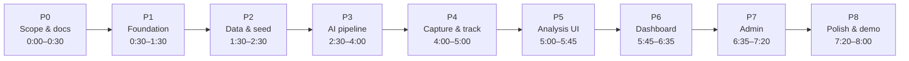

# CivicPulse AI — Phased Delivery Plan

| Field | Value |
| --- | --- |
| Product | CivicPulse AI |
| Document | Phased execution plan |
| Version | 1.0 |
| Horizon | 8-hour hackathon + 6-month evolution |
| Event | PromptWars x ASTRA — AI for Civic Impact |
| Team | Solo |
| Last updated | 30 October 2026 |
| Related | [`prd.md`](./prd.md) · [`trd.md`](./trd.md) · [`architecture.md`](./architecture.md) |

---

## 1. How to use this plan

This document converts the PRD, TRD and architecture into an **ordered build sequence** with time boxes, file-level tasks, acceptance gates and demo checkpoints.

Rules:

1. **Phases are sequential.** Do not start Phase 3 before the Phase 2 gate passes; AI without data is a demo of nothing.
2. **Every phase ends with a runnable app.** No phase leaves `npm run dev` broken.
3. **Gates are binary.** If a gate fails, fix it or invoke the cut order in §14; do not carry debt forward silently.
4. **Demo checkpoints are rehearsed.** The 5-minute journey is tested at C3, C5 and C6, not only at the end.
5. **Docs are the source of truth.** If implementation diverges, update the doc in the same phase.

The PRD §18 table is the executive summary. **This file is the granular execution schedule.**

---

## 2. Phase map



**Critical path:** P1 → P2 → P3 → P4 → P6 → P7 → P8.
**Can slip without blocking:** P5 (analysis polish), P6 charts (keep map + KPIs), P7 secondary tabs.

---

## 3. Timeline at a glance

| Phase | Window | Duration | Primary output | Gate |
| --- | --- | --- | --- | --- |
| P0 | 0:00–0:30 | 30 min | Frozen scope, docs, seed spec | G0 |
| P1 | 0:30–1:30 | 60 min | Runnable shell, six routes, design tokens | G1 |
| P2 | 1:30–2:30 | 60 min | Repository, 42-report seed, hooks | G2 |
| P3 | 2:30–4:00 | 90 min | Working AI pipeline + tests | G3 |
| P4 | 4:00–5:00 | 60 min | Submit → analysis → track loop | G4 |
| P5 | 5:00–5:45 | 45 min | Explainability UI | G5 |
| P6 | 5:45–6:35 | 50 min | Dashboard, map, hotspots, brief | G6 |
| P7 | 6:35–7:20 | 45 min | Operator workflow | G7 |
| P8 | 7:20–8:00 | 40 min | QA, README, rehearsal | G8 |
| **Total** | | **480 min** | Working prototype | |

**Buffer policy:** there is no separate buffer. The cut order in §14 creates buffer by removing scope, not by extending time.

---

## 4. Phase 0 — Scope lock and documentation

**Window:** 0:00–0:30 (30 min)
**Depends on:** nothing
**Status:** documentation complete; scope frozen

### Goal

Eliminate ambiguity before writing UI code: routes, categories, statuses, thresholds, seed composition and the exact demo journey.

### Tasks

- [x] **P0-T1** Confirm the four lifecycle stages and the six required routes.
- [x] **P0-T2** Freeze taxonomy: 7 categories, 8 statuses, 4 priority bands.
- [x] **P0-T3** Freeze AI thresholds: duplicate 300 m / 21 days / 0.62 review (0.68 originally; lowered for the demo per §19) / 0.82 strong; cluster 0.003° / 30 days / min 3.
- [x] **P0-T4** Define the 42-report seed composition (duplicates, P0s, two clusters).
- [x] **P0-T5** Write `prd.md`, `trd.md`, `architecture.md`.
- [x] **P0-T6** Write this phase plan.
- [x] **P0-T7** Create the repository, initial commit, and `docs/decision-log.md`.

### Deliverables

| Artifact | Location |
| --- | --- |
| Product requirements | `prd.md` |
| Technical requirements + code | `trd.md` |
| System architecture | `architecture.md` |
| Phase plan | `phases.md` |
| Seed specification | `trd.md` §8.5 |
| Decision log + G0 sign-off | `docs/decision-log.md` |

### Acceptance gate G0

- [x] The six routes and their audiences are unambiguous.
- [x] The AI capability list is fixed (classify, summarise, dedupe, prioritise, cluster, brief).
- [x] The seed composition adds up to 42 and includes 8 duplicate groups, 3 P0s, 2 clusters.
- [x] No document promises an integration the prototype will not have.
- [x] The demo journey can be described in five sentences.
- [x] `prd.md` §18 timeline and cut order agree with this file (see D-006).

**G0 result: PASSED.** Recorded in `docs/decision-log.md` §2. Proceed to Phase 1.

### If behind

Do not spend more than 30 minutes on docs. Freeze what exists; implementation clarity matters more than prose polish.

---

## 5. Phase 1 — Foundation and application shell

**Window:** 0:30–1:30 (60 min)
**Depends on:** G0
**Goal:** A runnable, responsive shell with all routes, design tokens and reusable primitives.

### Tasks

- [x] **P1-T1** Scaffold Vite + React and install pinned dependencies (`trd.md` §3).
- [x] **P1-T2** Replace `package.json`, `vite.config.js`, `tailwind.config.js`, `postcss.config.js`, `index.html`, `jsconfig.json`, `eslint.config.js`.
- [x] **P1-T3** Add `src/index.css` tokens and component classes (`trd.md` §7).
- [x] **P1-T4** Add `src/main.jsx` and `src/app/App.jsx` with all routes.
- [x] **P1-T5** Build `AppLayout`, `Header`, `Footer`, `MobileNav`, `Container`, `PageHeader`.
- [x] **P1-T6** Build `AdminLayout` with sidebar/top bar and a back-to-site link.
- [x] **P1-T7** Build UI primitives: `Button`, `Card`, `Badge`, `EmptyState`, `Skeleton`, `HonestyNote`, `ToastViewport`.
- [x] **P1-T8** Create placeholder pages: Home, ReportIssue, Analysis, AnalysisDetail, Dashboard, Admin, Track, TrackDetail, NotFound.
- [x] **P1-T9** Add the data-mode badge ("Demo mode · local data") and the footer honesty block.
- [x] **P1-T10** Verify 360 px, 768 px and 1366 px widths; no horizontal scroll. *(class audit done; visual pass repeated at G8)*
- [x] **P1-T11** Add `src/app/__tests__/routes.smoke.test.js` — SSR render of every route.

### Deliverables

- `npm run dev` opens a styled shell.
- All six routes are reachable from desktop and mobile navigation.
- Active navigation state, skip link, focus ring and 44 px tap targets.
- No console errors and no missing assets.

### Acceptance gate G1

```bash
npm run dev
npm run build
npm run test
```

- [x] Dev server starts on `http://localhost:5173/` (verified on port 5180 for automation; HTTP 200 + entry script).
- [x] Every route renders without a blank screen (9/9 SSR smoke tests pass).
- [x] Mobile drawer opens/closes; ESC closes it (implemented with keydown + scroll lock).
- [x] Footer badge accurately says local demo mode (env resolution defaults to local).
- [x] `npm run build` succeeds (224 kB JS / 46 kB CSS, 4.9 s).
- [x] `npm run lint` passes with zero warnings.
- [x] `npm run test` passes (9 tests).

**G1 result: PASSED.** Recorded in `docs/decision-log.md`.

### Demo checkpoint C1

Navigate Home → Report → Dashboard → Track → Admin → back Home on a phone-sized window. It should already feel like a product, even with placeholder content.

### If behind

Skip `AdminLayout` polish and secondary UI primitives. Keep the public shell and route map. Admin can use the public shell until P7.

---

## 6. Phase 2 — Data layer and synthetic seed

**Window:** 1:30–2:30 (60 min)
**Depends on:** G1
**Goal:** Real data flowing through a stable repository interface, with 42 believable reports.

### Tasks

- [x] **P2-T1** Add `src/lib/constants.js` (categories, statuses, priority meta, departments, transitions, thresholds).
- [x] **P2-T2** Add `src/lib/env.js`, `geo.js`, `format.js`, `referenceCode.js`, `validation.js`, `logger.js`, `errors.js`, `image.js`.
- [x] **P2-T3** Author `src/data/seedReports.js` with 42 human-written reports:
  - 11 water, 9 roads, 8 waste, 6 electricity, 4 sanitation, 3 public safety, 1 other — asserted in `localRepository.test.js`.
  - 8 duplicate groups (5 pairs + 3 triplets) — seeded as `duplicate_candidates`, human-confirmed per D-005.
  - 3 P0 safety cases — computed by `rules-v1` (current distribution 3 P0 / 5 P1 / 11 P2 / 23 P3; see D-008).
  - Sector 12 cluster (7 reports) and Ward 4 market cluster (5 reports).
  - Timestamps spread across 30 days; 6 in the last 48 hours.
- [x] **P2-T4** Build `src/services/local/localRepository.js` and `storage.js` with seed + reset.
- [x] **P2-T5** Build `src/services/supabase/client.js` (null-safe) and `supabaseRepository.js` skeleton.
- [x] **P2-T6** Add `src/services/index.js` adapter selection.
- [x] **P2-T7** Add `src/hooks/useReports.js`, `useReport.js`, `useClusters.js`, `useToast.js`.
- [x] **P2-T8** Wire Home and Dashboard placeholders to show real counts.
- [x] **P2-T9** Add "Reset demo data" in the footer (local mode only).
- [x] **P2-T10** Add `src/types/index.js` JSDoc contracts.

### Deliverables

- 42 reports load from seed on first run.
- Reports persist in `localStorage`; reset restores the seed.
- Repository interface is async and identical in shape to the Supabase adapter.
- Home shows real totals; Dashboard shows a raw report list.
- Data-mode resolution works with and without `.env`.

### Acceptance gate G2

- [x] `localStorage` contains `civicpulse:v1:reports` with 42 rows.
- [x] Category counts and status counts match the seed spec — `localRepository.test.js` asserts 11/9/8/6/4/3/1 and 8/7/6/6/9/2/2/2.
- [x] Reset removes and reseeds cleanly — mutation to 43 rows, reset returns 42.
- [x] `useReports()` returns `{ data, loading, error, reload }`.
- [x] No component imports `localStorage` or Supabase directly — only `src/services/*` touches storage.
- [x] `npm run build` still passes — Vite build 4.6 s, 1768 modules.

### Demo checkpoint C2

Show the seeded data through a temporary list on Dashboard: 42 reports, mixed priorities/statuses, two visible geographic groups. This proves the data foundation before AI.

### If behind

Ship 30 reports instead of 42, but keep all 8 duplicate groups and both clusters. Duplicate and cluster demos depend on them.

---

## 7. Phase 3 — AI pipeline

**Window:** 2:30–4:00 (90 min)
**Depends on:** G2
**Goal:** Real, deterministic, explainable AI over the seeded corpus, with unit tests.

### Tasks

- [x] **P3-T1** `normalize.js`: lowercase, punctuation strip, stopwords, sentences, truncate.
- [x] **P3-T2** `tfidf.js`: corpus index, vectorise, cosine, light suffix stemming for inflections.
- [x] **P3-T3** `classify.js`: weighted lexicon, confidence, alternatives, low-confidence flag.
- [x] **P3-T4** `summarize.js`: extractive sentence ranking, ≤220 chars.
- [x] **P3-T5** `duplicates.js`: text/category/geo/time score, thresholds, reasons.
- [x] **P3-T6** `priority.js`: five additive factors, band boundaries, verdict, cap handling and the D-008 critical-hazard P0 floor.
- [x] **P3-T7** `clusters.js`: grid key, 30-day window, centroid, radius, hotspot score, trend.
- [x] **P3-T8** `brief.js`: template from cluster fields with owner and MOCKED note.
- [x] **P3-T9** `pipeline.js`: orchestrate and package `AiAnalysis`.
- [x] **P3-T10** Integrate analysis into local seed (two-pass) and `createReport`.
- [x] **P3-T11** Write `__tests__/ai.test.js` (`trd.md` §15.1).
- [x] **P3-T12** Run `scripts/evaluate-seed.mjs` and record metrics.

### Deliverables

- Every seeded report has `ai.category`, `ai.summary`, `ai.priority`, `ai.duplicates`, `ai.cluster`.
- Priority factors sum to the score.
- Duplicate pairs are generated with component scores.
- Two clusters are detected.
- Unit tests pass.

### Acceptance gate G3

```bash
npm run test
npm run build
```

- [x] Classification detects water/roads/waste/electricity correctly on seed samples.
- [x] Band boundaries 80/60/40 behave exactly.
- [x] Identical text + location + time yields a `strong` duplicate.
- [x] Distant reports are not matched.
- [x] Three reports in one cell produce one cluster.
- [x] Determinism test passes (ignoring `processingMs`).
- [x] ≥6/8 duplicate groups surfaced.
- [x] 3/3 P0 reports in the top 5 by score.
- [x] 2 clusters found.

**G3 result: PASSED (30 October 2026).** `scripts/evaluate-seed.mjs` at `2026-10-30T12:00:00.000Z`: **8/8 duplicate groups**, **3/3 P0 in the top 5** (live wire 80, open manhole 80, road collapse 80, all via the D-008 hazard floor), **2 clusters** (Sector 12: 7 reports, 31 m radius; Ward 4 Market: 5 reports, 30 m radius), **3 low-confidence** reports. Distribution: **3 P0 / 5 P1 / 11 P2 / 23 P3**. `npm run test` 59 passed in 6 files; `npm run lint` 0 problems; `npm run build` passes. Recorded in `docs/decision-log.md`.

### Demo checkpoint C3

Run the pipeline on a prepared waterlogging description in the browser console or a temporary debug panel. Read the category, confidence, duplicate scores, priority factors and cluster aloud. This is the first "AI is real" moment.

### If behind

Cut the optional duplicate pre-check on the report form, not the pipeline. Cut the action brief template only if P6 is also at risk. Keep classification, duplicates, priority and cluster.

---

## 8. Phase 4 — Capture and tracking loop

**Window:** 4:00–5:00 (60 min)
**Depends on:** G3
**Goal:** A citizen can submit in under a minute and follow the result by code.

### Tasks

- [x] **P4-T1** Build `ReportIssue` page with three visual groups: problem, location, evidence/contact.
- [x] **P4-T2** Wire `LocationPicker` (Leaflet, tap/drag, lat/lng readout).
- [x] **P4-T3** Wire category select + real "Suggest category" using `classifyReport`.
- [x] **P4-T4** Wire optional image validation/preview (no AI analysis, labelled).
- [x] **P4-T5** Add `validateReport` on submit and blur; focus first invalid field.
- [x] **P4-T6** Call `createReport`, handle loading/error, navigate to `/analysis/:id`.
- [x] **P4-T7** Add success banner + tracking code with copy button.
- [x] **P4-T8** Build `Track` lookup page (code input, recent codes, empty state).
- [x] **P4-T9** Build `TrackDetail` with public timeline and status hero.
- [x] **P4-T10** Ensure internal notes are excluded from the public query.

### Deliverables

- Complete submit flow with real AI output attached.
- `CP-XXXXXX` code generated and lookup works case-insensitively.
- Timeline shows `created` + `ai_processed` events.
- Mobile submit flow fits 360 px and has a sticky action bar.
- Error states preserve form values.

### Acceptance gate G4

- [x] Submit a prepared report in <60 seconds on a 390 px viewport.
- [x] Validation blocks <20 chars, missing pin and >5 MB images.
- [x] Successful submit returns a code and navigates to analysis.
- [x] `/track/<code>` renders the report and public events.
- [x] Unknown code shows a helpful empty state, not a 404.
- [x] Refresh does not lose persisted reports.

**G4 result: PASSED (30 October 2026).** Validation is covered by `src/lib/__tests__/validation.test.js` (short description, empty pin, >5 MB image, tracking-code formats). `localRepository.test.js` covers code generation, case-insensitive lookup, public/internal event filtering, recent-code persistence and reset-persistence. The mobile form is three groups with a sticky bottom action bar and `390 px` layout; timings should still be rehearsed live before judging. `npm run test` 59 passed in 6 files; `npm run lint` 0 problems; `npm run build` passes (1773 modules). Recorded in `docs/decision-log.md`.

### Demo checkpoint C4

Submit the waterlogging report live, copy the code, open the tracking page. The loop "citizen → system → citizen" now exists.

### If behind

Cut image upload (keep the field labelled "coming soon" or remove it) and the draft restore. Keep map pin, validation, submit and tracking.

---

## 9. Phase 5 — AI Analysis UI

**Window:** 5:00–5:45 (45 min)
**Depends on:** G4
**Goal:** Make every AI decision legible to a judge in under 30 seconds.

### Tasks

- [ ] **P5-T1** Build `Analysis` overview: pipeline strip, latest analysis, recent table, model card.
- [ ] **P5-T2** Build `AnalysisDetail` header: code, status, priority, category, time, location.
- [ ] **P5-T3** Add original description + photo evidence disclaimer + mini-map.
- [ ] **P5-T4** Add `AiSummaryCard`, category confidence + alternatives.
- [ ] **P5-T5** Add `PriorityFactors` table with points, reasons and verdict.
- [ ] **P5-T6** Add `DuplicateList` with component bars, reasons and "Open comparison".
- [ ] **P5-T7** Add `HotspotCard` with count, category mix, radius, trend.
- [ ] **P5-T8** Add model card line: `rules-v1 · deterministic · N ms`.
- [ ] **P5-T9** Add low-confidence warning, no-cluster message, unknown-id state.
- [ ] **P5-T10** Add "Copy summary" and links to tracking/admin.

### Deliverables

- A judge can point at any number and trace where it came from.
- Duplicate evidence shows text/geo/time components, not just a score.
- Priority shows the arithmetic and a plain-language verdict.
- Cluster membership is visible and linked to the dashboard.
- No claim of image analysis or accuracy percentages.

### Acceptance gate G5

- [ ] Every AI field from the pipeline is rendered somewhere.
- [ ] Factor points sum to the displayed score.
- [ ] Low confidence (<0.45) shows the review notice.
- [ ] No cluster shows the "needs 3 related reports" message.
- [ ] Unknown id shows a lookup, not a crash.
- [ ] Page works at 360 px with stacked cards.

### Demo checkpoint C5

Read the analysis page as a story: "It classified this as water with 98% confidence, found two likely duplicates, scored it 79/P1 because of these five factors, and placed it in this hotspot."

### If behind

Cut the alternatives chart and the copy button. Keep the factor table, duplicate components and cluster card — those are the explainability core.

---

## 10. Phase 6 — Dashboard, map and hotspots

**Window:** 5:45–6:35 (50 min)
**Depends on:** G3 + G4 (data + clusters)
**Goal:** Reveal patterns that a list hides, in one screen.

### Tasks

- [ ] **P6-T1** Build KPI row: total, open, P0+P1, resolved (30 d), duplicate rate.
- [ ] **P6-T2** Build `MapView` with priority pins, hotspot circles, popups, legend.
- [ ] **P6-T3** Build "Fix first" ranked list with expandable factors.
- [ ] **P6-T4** Build category bar chart, priority donut, 14-day trend area chart.
- [ ] **P6-T5** Build hotspot cards with count, mix, avg priority, trend, brief button.
- [ ] **P6-T6** Build action brief modal with copy button and MOCKED note.
- [ ] **P6-T7** Add filters (category, status, band, search) with URL params.
- [ ] **P6-T8** Add loading skeletons, empty filter state and error retry.
- [ ] **P6-T9** Add "About this data" honesty footer (42 synthetic reports).
- [ ] **P6-T10** Verify map/list consistency and mobile stacking.

### Deliverables

- Two seeded hotspots visible as circles and cards.
- KPIs, map, charts and ranked list all derive from the same filtered array.
- Brief generated from real cluster fields.
- Filters compose and preserve state in the URL.
- Map degrades gracefully without tiles.

### Acceptance gate G6

- [ ] Sector 12 and Ward 4 market clusters are visible.
- [ ] Clicking a marker opens a popup with a working analysis link.
- [ ] KPI values match a manual count on the same filters.
- [ ] Charts render with no animation and handle empty data.
- [ ] Brief contains count, category mix, owner, action and MOCKED note.
- [ ] No horizontal scroll at 360 px; map has a list alternative.

### Demo checkpoint C6

Open Dashboard, point at Sector 12, read the brief, then click through to the top-ranked report. This is the "reveal" beat of the demo.

### If behind

Cut the trend chart and donut; keep the bar chart, map, KPIs and hotspot cards. Cut filters before cutting the map.

---

## 11. Phase 7 — Admin workflow

**Window:** 6:35–7:20 (45 min)
**Depends on:** G4 + G5
**Goal:** A complete operator loop: triage, assign, progress, resolve, with citizen-visible events.

### Tasks

- [ ] **P7-T1** Build Admin tabs: Queue, Duplicates, Hotspots, Reports.
- [ ] **P7-T2** Build priority-sorted queue (table desktop, cards mobile).
- [ ] **P7-T3** Build detail drawer with AI summary, factors, map, history.
- [ ] **P7-T4** Add department assignment + SLA default by band.
- [ ] **P7-T5** Add status stepper with `ALLOWED_TRANSITIONS` guard.
- [ ] **P7-T6** Require a public note on resolve; support internal notes.
- [ ] **P7-T7** Build duplicate review with side-by-side text and component scores.
- [ ] **P7-T8** Implement confirm/reject merge with events on both reports.
- [ ] **P7-T9** Add Hotspots tab with brief generation.
- [ ] **P7-T10** Add Reports tab search + CSV export (formula-injection safe).
- [ ] **P7-T11** Verify tracking page reflects every public event immediately.

### Deliverables

- Operator can move a report from submitted to resolved in under 60 seconds.
- Invalid transitions are disabled and guarded.
- Duplicate confirmation updates child, parent, events and queue.
- Internal notes never appear on `/track`.
- CSV export works client-side.

### Acceptance gate G7

- [ ] Assign a report → status becomes `assigned` and an event appears.
- [ ] Move to `in_progress` → public event appears on tracking.
- [ ] Resolve without a note is blocked; with a note it succeeds.
- [ ] Confirm a duplicate → child becomes `duplicate`, parent gains an event.
- [ ] Reject a duplicate → both reports remain open.
- [ ] Refresh preserves all changes.
- [ ] No direct repository calls from components.

### Demo checkpoint C7

Run the full journey: submit → analysis → dashboard hotspot → admin assign → resolve → citizen tracking. Time it.

### If behind

Cut CSV export and the Hotspots tab. Keep Queue, detail drawer, assignment, status transitions and duplicate confirmation. Without those, the "Act" stage is missing.

---

## 12. Phase 8 — Polish, QA and demo readiness

**Window:** 7:20–8:00 (40 min)
**Depends on:** G7
**Goal:** A clean, honest, rehearsed five-minute demo with no surprises.

### Tasks

- [ ] **P8-T1** Audit every route for loading, empty and error states.
- [ ] **P8-T2** Keyboard-only citizen flow; focus rings; modal ESC/focus trap.
- [ ] **P8-T3** Responsive QA at 360, 390, 768, 1024, 1366, 1440.
- [ ] **P8-T4** Console audit: zero errors, no missing assets, no failed requests except optional tiles.
- [ ] **P8-T5** Add honesty labels: demo mode, photo not analysed, mocked notifications/dispatch.
- [ ] **P8-T6** Write `README.md`: setup, architecture, AI approach, demo script, limitations.
- [ ] **P8-T7** Reset seed; run the full demo twice with a timer.
- [ ] **P8-T8** Test offline/airplane mode for the core flow.
- [ ] **P8-T9** `npm run lint`, `npm run test`, `npm run build`, `npm run preview`.
- [ ] **P8-T10** Tag `v0.1.0-hackathon`; record the backup demo video.

### Deliverables

- Clean build and clean console.
- README with runnable commands and an honest limitations section.
- A timed demo under 5 minutes with a fallback plan.
- Local-mode reset instructions.

### Acceptance gate G8

- [ ] `npm install && npm run dev` works from a clean clone.
- [ ] `npm run build` and `npm run preview` work.
- [ ] `npm run test` passes.
- [ ] `npm run lint` passes (or only documented warnings).
- [ ] Full journey <5 minutes, twice in a row.
- [ ] No console errors on any route.
- [ ] Honesty note matches the actual implementation.
- [ ] Demo works with no network (tiles may be grey).

### Demo checkpoint C8

Final rehearsal with a stopwatch, a phone-sized window, and a judge-style question after each beat: "Why this priority?", "Is this AI real?", "What is mocked?"

---

## 13. Phase gates (go / no-go)

| Gate | Question | Pass criteria | If fail |
| --- | --- | --- | --- |
| **G0** | Is scope unambiguous? | Routes, categories, statuses, thresholds, seed spec frozen | Spend max 15 more minutes, then freeze |
| **G1** | Does the shell run? | Six routes, responsive nav, `npm run build` | Fix routes before data work |
| **G2** | Does data flow? | 42 reports, repository interface, reset | Reduce to 30 reports, keep duplicates/clusters |
| **G3** | Is AI real and explainable? | Tests pass, metrics met, factors sum | Cut optional UI, not AI modules |
| **G4** | Can a citizen complete the loop? | Submit <60 s, code, tracking timeline | Cut image upload, keep map/submit/track |
| **G5** | Is the AI legible? | All outputs visible, low-confidence state | Cut alternatives chart, keep factors |
| **G6** | Are patterns visible? | 2 hotspots, map, KPIs, brief | Cut charts, keep map + KPIs + cards |
| **G7** | Can an operator act? | Assign, transition, resolve, duplicate merge | Cut CSV/Hotspots tab, keep queue/transitions |
| **G8** | Is it demo-ready? | Clean console, timed run, honest README | Cut polish scope, rehearse more |

---

## 14. Cut order and contingency

If a phase overruns, cut from the top of this list. Never cut from the bottom.

| Priority | Cut | Impact | Phase |
| --- | --- | --- | --- |
| 1 | CSV export | Low | P7 |
| 2 | SLA due dates | Low | P7 |
| 3 | Trend area chart | Low | P6 |
| 4 | Priority donut | Low | P6 |
| 5 | Duplicate pre-check on report form | Low | P4 |
| 6 | Draft restore | Low | P4 |
| 7 | Hotspots tab in admin | Medium | P7 |
| 8 | Action brief modal (show inline card instead) | Medium | P6 |
| 9 | Filters | Medium | P6 |
| 10 | Admin Reports tab | Medium | P7 |
| 11 | Photo upload | Medium | P4 |
| 12 | Analysis overview page (`/analysis`) | Low-medium | P5 |
| 13 | Recharts entirely (keep map + KPI + lists) | High | P6 |
| 14 | Admin duplicate review (keep status + assignment) | High | P7 |
| — | **Never cut:** submit, AI factor table, tracking timeline, hotspot map, honesty labels | Critical | — |

### If ahead of schedule

1. Add the pre-submit duplicate warning (P4).
2. Add the action brief drawer + copy (P6).
3. Add CSV export (P7).
4. Add `React.lazy` route splitting and a Lighthouse pass (P8).
5. Add one extra Playwright happy-path test (P8).

---

## 15. File creation order

Build in this order to keep imports valid and the app runnable at every step.

```text
1.  package.json, vite.config.js, tailwind.config.js, postcss.config.js,
    index.html, jsconfig.json, eslint.config.js, .env.example, .gitignore
2.  src/index.css
3.  src/main.jsx
4.  src/lib/constants.js, env.js, geo.js, format.js, referenceCode.js,
    validation.js, errors.js, image.js, logger.js
5.  src/types/index.js
6.  src/data/seedReports.js
7.  src/services/ai/normalize.js, tfidf.js, classify.js, summarize.js,
    duplicates.js, priority.js, clusters.js, brief.js, pipeline.js
8.  src/services/local/storage.js, localRepository.js
9.  src/services/supabase/client.js, mappers.js, supabaseRepository.js
10. src/services/index.js
11. src/app/providers.jsx
12. src/hooks/useToast.js, useReports.js, useReport.js, useClusters.js
13. src/components/ui/*.jsx
14. src/components/layout/*.jsx
15. src/app/App.jsx
16. src/pages/Home.jsx, NotFound.jsx (shell validation)
17. src/components/map/*.jsx, charts/*.jsx, reports/*.jsx
18. src/pages/ReportIssue.jsx, Analysis.jsx, AnalysisDetail.jsx
19. src/pages/Dashboard.jsx
20. src/pages/Admin.jsx
21. src/pages/Track.jsx, TrackDetail.jsx
22. src/services/ai/__tests__/ai.test.js
23. scripts/evaluate-seed.mjs, seed-supabase.mjs
24. README.md
```

**Rule:** after steps 1–5 and 15, the app must boot with placeholders. Do not create 20 files before the first `npm run dev`.

---

## 16. Demo checkpoints

| Checkpoint | After | What is proven | Time |
| --- | --- | --- | --- |
| C1 | P1 | Navigation and visual system | 2 min |
| C2 | P2 | Real seeded data | 2 min |
| C3 | P3 | AI classification, duplicates, priority, cluster | 3 min |
| C4 | P4 | Submit and track loop | 3 min |
| C5 | P5 | Explainability | 3 min |
| C6 | P6 | Hotspots and brief | 3 min |
| C7 | P7 | Operator workflow | 5 min |
| C8 | P8 | Full rehearsed demo | 5 min |

**Checkpoint rule:** if a checkpoint fails, do not start the next phase. Fix the failing loop or invoke the cut order.

---

## 17. Post-hackathon roadmap

These phases are **not** part of the 8-hour build. They show the path from prototype to a credible pilot.

### P9 — Hardening (weeks 1–2)

**Goal:** Make the prototype safe for a small, real pilot.

| Workstream | Deliverables | Exit criteria |
| --- | --- | --- |
| Server-side AI | Supabase Edge Function computes `AiAnalysis` on insert; client recomputes for display only | Client can no longer forge AI fields |
| Auth | Anonymous citizen auth, operator invites, role management UI | No manual SQL role edits |
| RLS | Replace public report read with an aggregated public view; tighten contacts/events | Pen-test checklist passes |
| Validation | Server-side Zod/JSON-schema validation; rate limits; CAPTCHA | Spam submission blocked |
| Tests | Playwright happy path + RLS integration tests | CI runs E2E on PR |
| Observability | Structured logs, error tracking with PII scrubbing | Alerts on failed AI runs |
| Docs | README, limitations, deployment guide, runbook | A new dev can deploy |

**Exit gate:** a real citizen can submit a non-sensitive report, and only staff can change status.

### P10 — Intelligence upgrade (weeks 3–6)

**Goal:** Improve language understanding and duplicate recall without losing explainability.

| Workstream | Deliverables | Exit criteria |
| --- | --- | --- |
| Embeddings | pgvector + multilingual embedding model for duplicate candidates | Recall improves on a labelled set |
| Clustering | PostGIS + `ST_ClusterDBSCAN` with time window | Boundary-split rate measured and reduced |
| Summaries | Constrained LLM rewrite behind a server proxy; deterministic fallback | No invented facts in eval |
| Priority calibration | Learn weights from resolution outcomes; fairness review | Override rate falls |
| Evaluation | 200+ labelled reports; precision/recall dashboard | Metrics tracked per release |
| Explainability | Factor table + counterfactual ("if this were not near a school…") | Judges/users understand rankings |

**Exit gate:** duplicate recall ≥ target on a held-out set; priority override rate < 20%.

### P11 — Scale and integrations (weeks 7–14)

**Goal:** Operate across multiple wards with real notifications and municipal workflows.

| Workstream | Deliverables | Exit criteria |
| --- | --- | --- |
| Queue | pgmq/SQS for AI, notifications, exports | Burst of 1,000 reports processed |
| Notifications | Email/SMS/WhatsApp adapters with consent + templates | Delivery receipts tracked |
| CRM | 311/municipal API adapter (or webhook) | Work orders created and status-synced |
| Multi-tenancy | City/ward scoping in RLS and UI | Two cities isolated |
| Dashboard | Materialised views, incremental refresh, exports | P95 dashboard < 2 s at 100k reports |
| Mobile | PWA install, offline draft, push | Lighthouse PWA pass |
| Public API | Read-only open data endpoints | API docs + keys |

**Exit gate:** a pilot ward runs its daily queue in the tool for two weeks.

### P12 — Operations and governance (ongoing)

**Goal:** Make the system accountable, fair and sustainable.

| Workstream | Deliverables | Exit criteria |
| --- | --- | --- |
| Audit | Immutable audit log, export, retention | Auditor can reconstruct every decision |
| Privacy | DPIA, deletion workflow, consent records | Legal review passed |
| Fairness | Ward-level equity monitoring, bias review | No systematic under-ranking of low-income wards |
| Model governance | Model cards, versioning, rollback, human review | Every AI version approved and documented |
| SLA automation | Escalation, reminders, breach alerts | P0 acknowledgement within target |
| Support | Runbooks, on-call, incident postmortems | 99.5% monthly availability |

**Exit gate:** the platform can be handed to an operations team without the original developer.

---

## 18. Phase-level definition of done

A phase is done only when all of the following are true:

- [ ] The app still starts with `npm run dev`.
- [ ] `npm run build` still succeeds.
- [ ] The phase's acceptance gate is checked and recorded.
- [ ] New code follows the layering rules (`architecture.md` §6.1).
- [ ] New UI works at 360 px and 1366 px.
- [ ] New async paths have loading, empty and error states.
- [ ] New AI logic has at least one unit test or a documented manual check.
- [ ] Any mocked behaviour is labelled in the UI.
- [ ] Docs are updated if behaviour diverged.
- [ ] A checkpoint demo has been run once.

---

## 19. Risks by phase

| Phase | Risk | Early signal | Mitigation |
| --- | --- | --- | --- |
| P1 | Tailwind/Leaflet setup friction | Build errors, unstyled page | Pin versions; import Leaflet CSS once; use `divIcon` |
| P2 | Seed data takes too long | <10 reports after 20 min | Generate variants programmatically, hand-edit descriptions |
| P3 | Duplicate thresholds miss seeded pairs | <4 groups surfaced | Lower review threshold to 0.62 for the demo; document it |
| P3 | Priority looks arbitrary | Factors don't match intuition | Show factors; tune urgency lexicon; accept overrides |
| P4 | Map picker blocks mobile submit | Pin hard to place | Add manual lat/lng inputs as fallback |
| P5 | Explanation page becomes a wall of text | Judge scrolls past | Summary first, factor table second, raw details collapsed |
| P6 | Dashboard inconsistency | KPI ≠ map | Single filtered array; compute once per render |
| P7 | Transition bugs | Invalid status appears | Central `canTransition` + service guard |
| P8 | Demo overruns | >6 min in rehearsal | Cut a beat; pre-fill the report; keep tracking short |

---

## 20. Handoff checklist

Before the first line of code:

- [ ] Node ≥20.11 and npm installed.
- [ ] `prd.md`, `trd.md`, `architecture.md`, `phases.md` read.
- [ ] `.env.local` planned; `VITE_DATA_MODE=local` for the first build.
- [ ] Demo story written in five sentences.
- [ ] Timer ready for the 8-hour window.

Before the demo:

- [ ] Seed reset and a known tracking code prepared.
- [ ] Phone-sized browser window bookmarked at `/report`.
- [ ] Dashboard pre-loaded.
- [ ] Admin tab pre-opened.
- [ ] Backup video recorded.
- [ ] Limitations note open in a second tab.

---

*End of phased delivery plan. Start with Phase 0, pass G0, and build only what the gate requires.*
